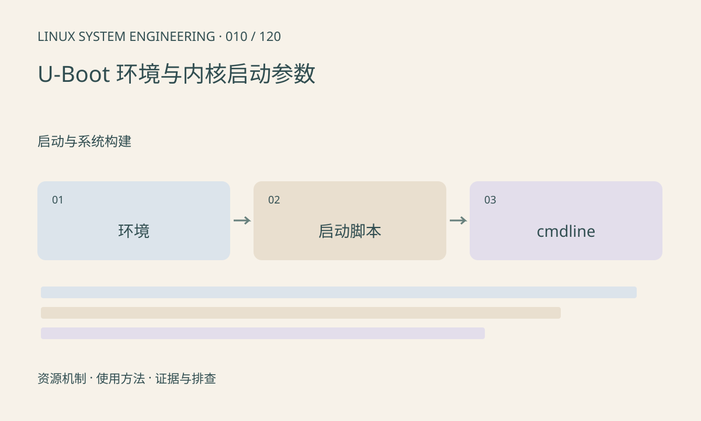

> 第 10 / 120 课 · 启动与系统构建。返回[课程合集](/series/embedded-linux-system-engineering/)。

## 机制与资源关系

U-Boot 环境变量和内核参数不是同一套命名空间。bootcmd 决定怎样加载和启动，bootargs 通常参与构造内核命令行，但最终结果还取决于启动脚本和设备树。修改内存中的环境与保存到介质也不同。



## 实际用法与观察入口

以下是操作说明；先确认执行环境、工具帮助和目标对象。设备名、PID、地址及项目名示例需要按实际替换，不能将整段命令当通用板端脚本执行。

```sh
# U-Boot 提示符下，只读查看
printenv bootcmd bootargs
# Linux 启动成功后
cat /proc/cmdline
```

## 输出解读与排查顺序

比较预期参数和实际 /proc/cmdline。root、console、分区布局错误会把故障带到不同阶段。先记录完整环境和恢复途径，再考虑持久化；本文不执行 saveenv 或修改分区。

### 情境推演

printenv bootargs 显示 root=/dev/mmcblk0p2，但 Linux 实际是 p3。查启动脚本是否重写 bootargs、是否采用另一启动介质，最后对照 /proc/cmdline；不要反复保存同一无效变量。

## 练习与参考分析

纸面分析 bootargs 已改但 Linux 参数未变的原因。参考检查：是否执行了另一启动分支、是否被脚本重写、是否启动了另一份镜像。

本课练习属于阅读、分析或板端观察。未在目标开发板执行，记录时应写明板型、内核配置、工具版本和原始输出。

## 官方资料与版本边界

- [本课参考资料](https://docs.u-boot.org/en/latest/usage/environment.html)

内核、工具和厂商 BSP 的支持范围需分别核对。参考资料可能对应较新版本；不要据此推定旧 BSP 支持所有接口。

[上一课：从 Boot ROM 到用户空间](/posts/linux-sys-009.html) · [下一课：内核配置、编译与模块](/posts/linux-sys-011.html)
