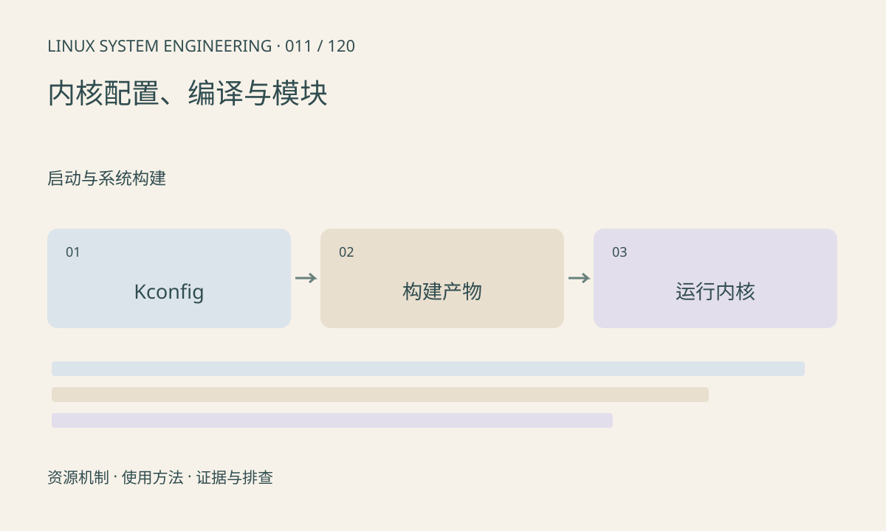

> 第 11 / 120 课 · 启动与系统构建。返回[课程合集](/series/embedded-linux-system-engineering/)。

## 机制与资源关系

CONFIG 项可以内建、作为模块或关闭。驱动是模块时还要有匹配的模块文件和依赖；启动根设备所需能力不能在无法访问根分区时才加载。配置、编译器和源码版本一起决定内核产物。



## 实际用法与观察入口

以下是操作说明；先确认执行环境、工具帮助和目标对象。设备名、PID、地址及项目名示例需要按实际替换，不能将整段命令当通用板端脚本执行。

```sh
uname -r
ls /lib/modules
# 仅在内核开启配置导出且有 zcat 时
zcat /proc/config.gz
```

## 输出解读与排查顺序

配置导出文件不存在不能证明功能关闭，应查构建输出中的 .config。外部模块除了版本字符串，还可能受符号版本、签名和配置影响；强制加载不能修复 ABI 不兼容。

### 情境推演

根分区在某存储控制器上，而该驱动只构建为模块且模块也放在根分区。没有早期用户空间帮助时形成依赖环。应内建必要能力或通过匹配的 initramfs 提前加载。

## 练习与参考分析

选择一项驱动，追踪 Kconfig→.config→内建或 ko→运行时绑定。参考结论：编译成功、安装成功、加载成功、设备可用是四个检查点。

本课练习属于阅读、分析或板端观察。未在目标开发板执行，记录时应写明板型、内核配置、工具版本和原始输出。

## 官方资料与版本边界

- [本课参考资料](https://docs.kernel.org/kbuild/modules.html)

内核、工具和厂商 BSP 的支持范围需分别核对。参考资料可能对应较新版本；不要据此推定旧 BSP 支持所有接口。

[上一课：U-Boot 环境与内核启动参数](/posts/linux-sys-010.html) · [下一课：设备树编译、加载与生效确认](/posts/linux-sys-012.html)
