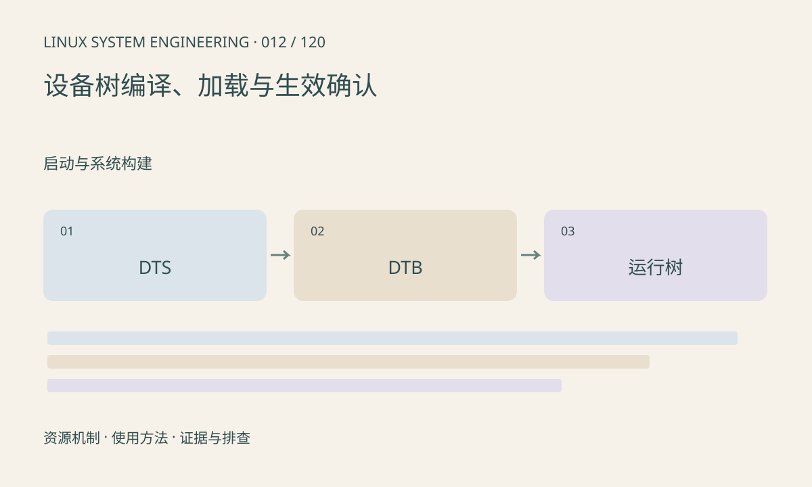

> 第 12 / 120 课 · 启动与系统构建。返回[课程合集](/series/embedded-linux-system-engineering/)。

## 机制与资源关系

DTS 描述硬件连接和资源，DTB 是编译结果，运行内核使用的是启动时传入并可能被修改的树。源码修改并不自动意味着板子加载了新 DTB；相同 compatible 也不能证明节点资源正确。



## 实际用法与观察入口

以下是操作说明；先确认执行环境、工具帮助和目标对象。设备名、PID、地址及项目名示例需要按实际替换，不能将整段命令当通用板端脚本执行。

```sh
ls /sys/firmware/devicetree/base
tr -d '\000' < /sys/firmware/devicetree/base/model
# 主机安装 dtc 后检查自有 DTB
dtc -I dtb -O dts board.dtb
```

## 输出解读与排查顺序

属性可能是字符串、字符串列表或大端整数，不能全部当普通文本。先确认加载路径与实际节点，再查 status、reg、interrupts 和供应资源。检查应使用对应内核 binding。

### 情境推演

修改 sensor 节点为 enabled 后无变化，先检查最终 DTB 的 status，再确认启动加载文件和运行树。仅查看编辑器中的 DTS 不能排除旧产物、错误板型或后续覆盖。

## 练习与参考分析

对照源码、构建 DTB 和运行树的同一节点。参考结论：只有运行树匹配预期，才进入驱动 probe 排查；不要先改寄存器掩盖错误描述。

本课练习属于阅读、分析或板端观察。未在目标开发板执行，记录时应写明板型、内核配置、工具版本和原始输出。

## 官方资料与版本边界

- [本课参考资料](https://docs.kernel.org/devicetree/usage-model.html)

内核、工具和厂商 BSP 的支持范围需分别核对。参考资料可能对应较新版本；不要据此推定旧 BSP 支持所有接口。

[上一课：内核配置、编译与模块](/posts/linux-sys-011.html) · [下一课：根文件系统与 initramfs](/posts/linux-sys-013.html)
