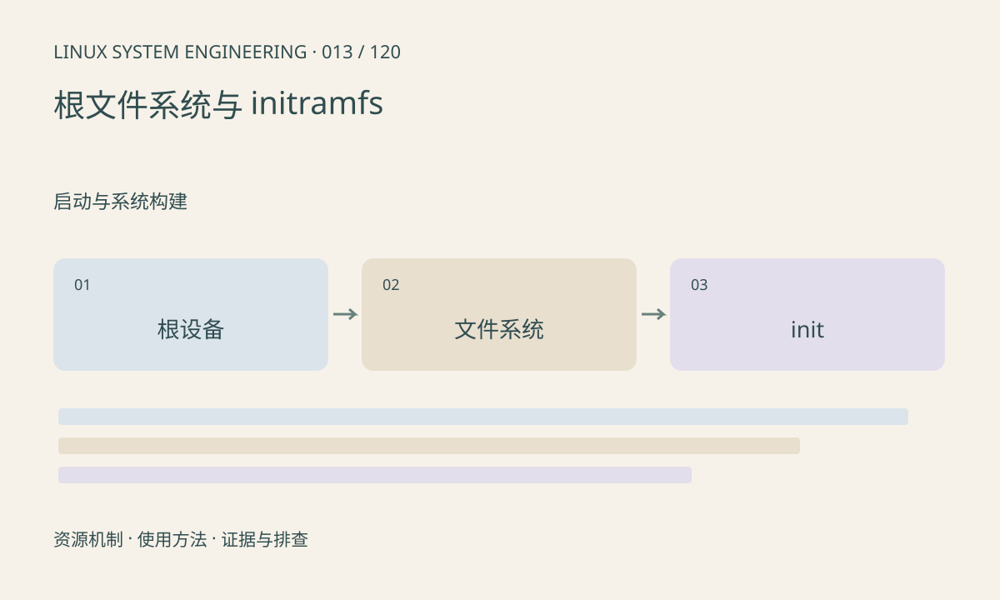

> 第 13 / 120 课 · 启动与系统构建。返回[课程合集](/series/embedded-linux-system-engineering/)。

## 机制与资源关系

initramfs 在内存中提供早期用户空间，可以准备设备后切换到实际根文件系统。内核找到根设备、识别文件系统、找到 init 并成功执行是不同步骤。动态链接的 init 还需要正确加载器和依赖库。



## 实际用法与观察入口

以下是操作说明；先确认执行环境、工具帮助和目标对象。设备名、PID、地址及项目名示例需要按实际替换，不能将整段命令当通用板端脚本执行。

```sh
cat /proc/mounts
ls -l /sbin/init /bin/sh
cat /proc/cmdline
```

## 输出解读与排查顺序

VFS unable to mount root fs 优先检查 root 参数、设备驱动和文件系统支持；No working init found 则继续查路径、权限、ELF 与加载器。不要把两类故障都归因于根镜像损坏。

### 情境推演

内核已经输出挂载根分区成功，随后找不到 init，此时继续改存储时序通常不是首选。查 init 是否存在、是否可执行，以及脚本或 ELF 指定的解释器是否随镜像一起安装。

## 练习与参考分析

制作两条决策路径：根设备不可见和 init 不可执行。参考结论：内核能挂载镜像仍不保证其中的用户程序架构正确。

本课练习属于阅读、分析或板端观察。未在目标开发板执行，记录时应写明板型、内核配置、工具版本和原始输出。

## 官方资料与版本边界

- [本课参考资料](https://docs.kernel.org/filesystems/ramfs-rootfs-initramfs.html)

内核、工具和厂商 BSP 的支持范围需分别核对。参考资料可能对应较新版本；不要据此推定旧 BSP 支持所有接口。

[上一课：设备树编译、加载与生效确认](/posts/linux-sys-012.html) · [下一课：BusyBox init、启动脚本与 systemd](/posts/linux-sys-014.html)
