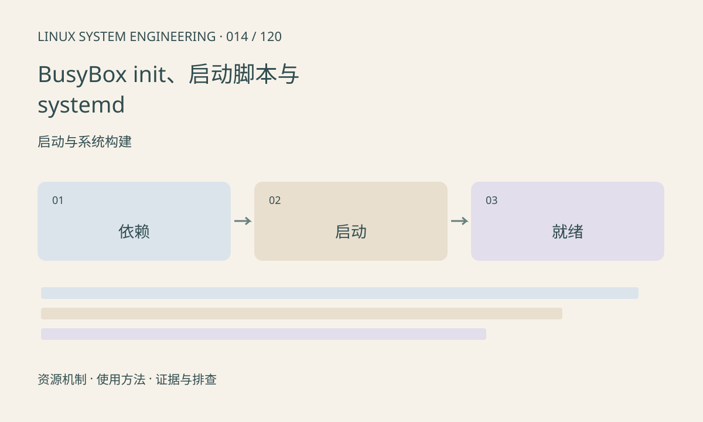

> 第 14 / 120 课 · 启动与系统构建。返回[课程合集](/series/embedded-linux-system-engineering/)。

## 机制与资源关系

PID 1 负责用户空间启动和进程回收。BusyBox init 常按 inittab 和脚本工作，systemd 按 unit 及依赖组织服务。顺序依赖与“对方已可提供业务”不同，启动脚本中的 sleep 也不能保证资源就绪。



## 实际用法与观察入口

以下是操作说明；先确认执行环境、工具帮助和目标对象。设备名、PID、地址及项目名示例需要按实际替换，不能将整段命令当通用板端脚本执行。

```sh
cat /proc/1/comm
readlink /proc/1/exe
# 以下仅适用于 systemd 系统
systemctl --failed
systemctl list-units --type=service
```

## 输出解读与排查顺序

先确认 init 实现。systemd 的 After 规定顺序，不会单独拉起依赖；服务实际就绪需要合适的协议。BusyBox 脚本应检查退出码，避免后台失败被启动过程吞掉。

### 情境推演

服务 A 在服务 B 之后启动，但 B 的后台初始化仍未完成，A 首次连接失败。应增加明确的就绪通知或有界重试。固定 sleep 可能偶尔掩盖问题，却在温度或负载变化后失效。

## 练习与参考分析

画出摄像头服务依赖的设备、目录和网络条件。参考结论：网络服务启动完成与远端服务器可达不是同一条件，应由业务实现有界重试。

本课练习属于阅读、分析或板端观察。未在目标开发板执行，记录时应写明板型、内核配置、工具版本和原始输出。

## 官方资料与版本边界

- [本课参考资料](https://www.freedesktop.org/software/systemd/man/latest/systemd.service.html)

内核、工具和厂商 BSP 的支持范围需分别核对。参考资料可能对应较新版本；不要据此推定旧 BSP 支持所有接口。

[上一课：根文件系统与 initramfs](/posts/linux-sys-013.html) · [下一课：Buildroot 工程构建与定制](/posts/linux-sys-015.html)
