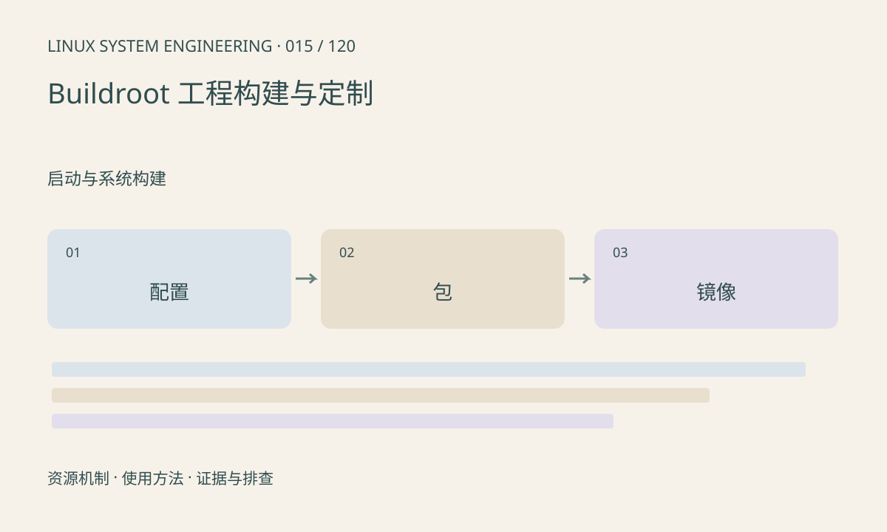

> 第 15 / 120 课 · 启动与系统构建。返回[课程合集](/series/embedded-linux-system-engineering/)。

## 机制与资源关系

Buildroot 组织工具链、内核、Bootloader 和根文件系统构建。output/target 是中间目录，不应直接当最终完整镜像部署；权限和设备节点等处理还可能发生在镜像阶段。defconfig、overlay 和自有包共同表达定制。



## 实际用法与观察入口

以下是操作说明；先确认执行环境、工具帮助和目标对象。设备名、PID、地址及项目名示例需要按实际替换，不能将整段命令当通用板端脚本执行。

```sh
# 在匹配版本的 Buildroot 源码目录执行，仅构建环境使用
make help
# 已完成配置后保存精简配置
make savedefconfig
```

## 输出解读与排查顺序

保存 board 配置和自有修改，避免只在 output/target 手工改文件。工具链和 ABI 变化可能要求完整重建；增量构建成功不能证明旧产物已全部替换。

### 情境推演

手工复制应用到 output/target 后镜像能跑，但全新构建缺程序。根因是修改未进入工程输入。将应用纳入 package 或受控 overlay，并确认安装规则及许可证信息。

## 练习与参考分析

设计一个自有应用包，列出源码版本、依赖、构建和安装步骤。参考结论：干净环境能重建同一功能，才比“手工复制后能跑”更可靠。

本课练习属于阅读、分析或板端观察。未在目标开发板执行，记录时应写明板型、内核配置、工具版本和原始输出。

## 官方资料与版本边界

- [本课参考资料](https://buildroot.org/downloads/manual/manual.html)

内核、工具和厂商 BSP 的支持范围需分别核对。参考资料可能对应较新版本；不要据此推定旧 BSP 支持所有接口。

[上一课：BusyBox init、启动脚本与 systemd](/posts/linux-sys-014.html) · [下一课：Yocto 的 layer、recipe 与镜像](/posts/linux-sys-016.html)
