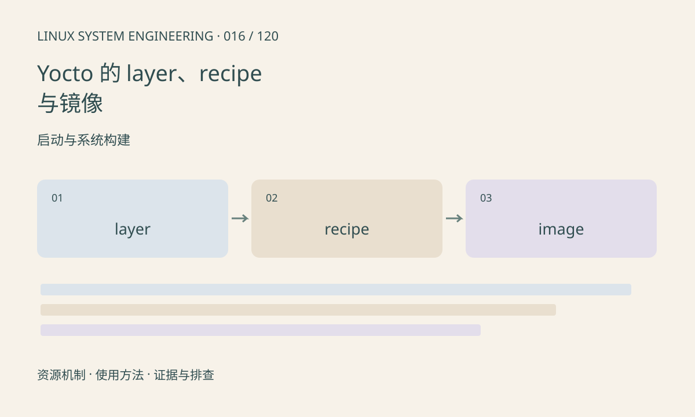

> 第 16 / 120 课 · 启动与系统构建。返回[课程合集](/series/embedded-linux-system-engineering/)。

## 机制与资源关系

BitBake 按 recipe 和任务图构建，layer 组织元数据，MACHINE 表示目标硬件配置，DISTRO 表达发行策略。镜像 recipe 决定装哪些包，SDK 提供与目标匹配的开发环境；修改工作目录不能替代维护 recipe。



## 实际用法与观察入口

以下是操作说明；先确认执行环境、工具帮助和目标对象。设备名、PID、地址及项目名示例需要按实际替换，不能将整段命令当通用板端脚本执行。

```sh
# 先进入项目指定版本的构建环境
bitbake-layers show-layers
bitbake-layers show-recipes
# 替换成已有 recipe，仅展开配置
bitbake -e your-recipe
```

## 输出解读与排查顺序

版本、layer 分支和兼容性需共同固定。检查变量的最终展开值及任务日志，不要只看某一个 conf 文件。缓存命中不是问题，但必须能说明输入变化是否进入任务签名。

### 情境推演

recipe 编译成功而镜像没有可执行文件，依次检查安装任务、文件归包规则和镜像包选择。构建依赖能让编译使用某库，却不必然把该库装进目标系统。

## 练习与参考分析

为一个应用画 recipe→package→image 的关系，并区分构建依赖与运行依赖。参考结论：编译成功却镜像无程序，可能是安装或镜像包选择遗漏。

本课练习属于阅读、分析或板端观察。未在目标开发板执行，记录时应写明板型、内核配置、工具版本和原始输出。

## 官方资料与版本边界

- [本课参考资料](https://docs.yoctoproject.org/overview-manual/concepts.html)

内核、工具和厂商 BSP 的支持范围需分别核对。参考资料可能对应较新版本；不要据此推定旧 BSP 支持所有接口。

[上一课：Buildroot 工程构建与定制](/posts/linux-sys-015.html) · [下一课：读懂 procfs 的系统与进程信息](/posts/linux-sys-017.html)
