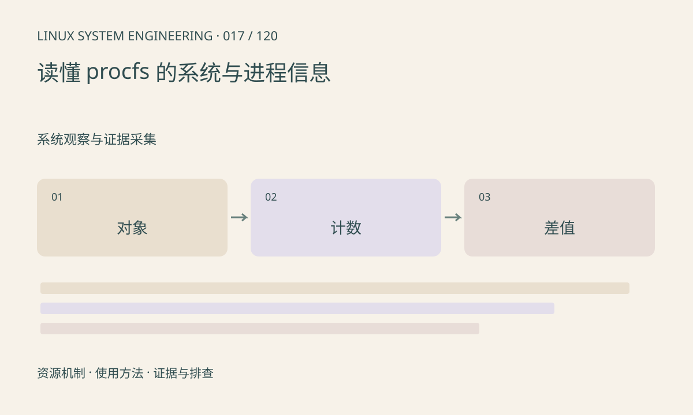

> 第 17 / 120 课 · 系统观察与证据采集。返回[课程合集](/series/embedded-linux-system-engineering/)。

## 机制与资源关系

/proc 以文件接口暴露内核状态。数字目录通常对应进程，self 指向访问者自身；进程消失时文件可以在两次访问之间消失。采集器应允许这种竞争，不应把短暂 ENOENT 当文件系统损坏。



## 实际用法与观察入口

以下是操作说明；先确认执行环境、工具帮助和目标对象。设备名、PID、地址及项目名示例需要按实际替换，不能将整段命令当通用板端脚本执行。

```sh
cat /proc/self/status
cat /proc/uptime
cat /proc/stat
cat /proc/meminfo
```

## 输出解读与排查顺序

/proc/stat 多数字段是累计计数，CPU 利用率需要两次采样差值。/proc/PID/stat 的 comm 字段可能含空格，不能随意按空格固定切列。权限和 PID namespace 会改变可见范围。

### 情境推演

两次读到某 CPU 的总计数分别是 10000 和 11000，空闲增量 700，在简化且同口径假设下忙碌比例约 30%。真实计算需明确 iowait 等字段口径，不能直接累加所有字段导致重复。

## 练习与参考分析

对同一进程间隔采样两次，区分瞬时值和累计值。参考结论：CPU 总时间大说明历史用得多，不等于当前占用高。

本课练习属于阅读、分析或板端观察。未在目标开发板执行，记录时应写明板型、内核配置、工具版本和原始输出。

## 官方资料与版本边界

- [本课参考资料](https://docs.kernel.org/filesystems/proc.html)

内核、工具和厂商 BSP 的支持范围需分别核对。参考资料可能对应较新版本；不要据此推定旧 BSP 支持所有接口。

[上一课：Yocto 的 layer、recipe 与镜像](/posts/linux-sys-016.html) · [下一课：sysfs：设备、属性与拓扑](/posts/linux-sys-018.html)
