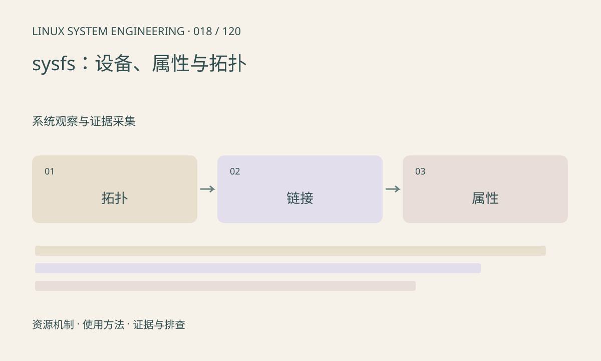

> 第 18 / 120 课 · 系统观察与证据采集。返回[课程合集](/series/embedded-linux-system-engineering/)。

## 机制与资源关系

/sys/devices 表达设备拓扑，/sys/class 和 /sys/bus 提供不同索引。多个路径可能通过软链接指向同一对象，不能重复统计为多个设备。属性由驱动导出，名称、单位和读写语义需要查 ABI 文档。



## 实际用法与观察入口

以下是操作说明；先确认执行环境、工具帮助和目标对象。设备名、PID、地址及项目名示例需要按实际替换，不能将整段命令当通用板端脚本执行。

```sh
ls /sys/class
ls /sys/bus
ls -l /sys/class/net
readlink -f /sys/class/net/lo
```

## 输出解读与排查顺序

先从 class 定位设备，再沿 device、driver 链接查绑定。属性缺失可能是驱动未绑定、内核差异或硬件不支持；不应直接补建普通文件。debugfs 与 sysfs 的稳定性承诺不同。

### 情境推演

/sys/class/net/eth0 和 /sys/devices 下某目录通过链接指向同一对象。统计时按实际对象去重；属性中的 carrier=1 说明链路状态，不能推导远端服务器已启动。

## 练习与参考分析

选择一个实际网卡，画 class 链接到物理设备的路径。参考结论：逻辑接口存在不代表物理链路已经建立。

本课练习属于阅读、分析或板端观察。未在目标开发板执行，记录时应写明板型、内核配置、工具版本和原始输出。

## 官方资料与版本边界

- [本课参考资料](https://docs.kernel.org/admin-guide/sysfs-rules.html)

内核、工具和厂商 BSP 的支持范围需分别核对。参考资料可能对应较新版本；不要据此推定旧 BSP 支持所有接口。

[上一课：读懂 procfs 的系统与进程信息](/posts/linux-sys-017.html) · [下一课：设备节点、设备号与动态管理](/posts/linux-sys-019.html)
