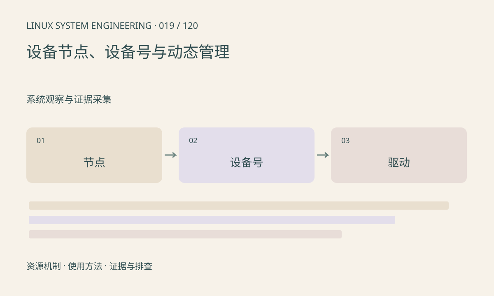

> 第 19 / 120 课 · 系统观察与证据采集。返回[课程合集](/series/embedded-linux-system-engineering/)。

## 机制与资源关系

字符和块设备节点保存设备号，打开时由内核转到对应驱动。节点文件不保存摄像头或串口的数据本体。devtmpfs、udev 或 mdev 可以负责创建节点和策略；手工 mknod 不能制造不存在的驱动。



## 实际用法与观察入口

以下是操作说明；先确认执行环境、工具帮助和目标对象。设备名、PID、地址及项目名示例需要按实际替换，不能将整段命令当通用板端脚本执行。

```sh
ls -l /dev/null /dev/zero
cat /proc/devices
cat /proc/mounts
```

## 输出解读与排查顺序

节点缺失时先查设备是否注册，再查 /dev 管理。Permission denied 检查目录、属主组、ACL 和安全策略；No such device 则更接近驱动和设备生命周期问题。

### 情境推演

手工建立 /dev/camera0 后 open 仍报 No such device，说明名字和设备号入口并未保证对应内核对象存在。回到驱动注册和绑定证据，而不是继续修改节点权限。

## 练习与参考分析

解释设备节点有主次设备号而普通文件有大小。参考结论：复制节点名称或放宽为 777 都不能解决内核没有对应设备的问题。

本课练习属于阅读、分析或板端观察。未在目标开发板执行，记录时应写明板型、内核配置、工具版本和原始输出。

## 官方资料与版本边界

- [本课参考资料](https://man7.org/linux/man-pages/man4/intro.4.html)

内核、工具和厂商 BSP 的支持范围需分别核对。参考资料可能对应较新版本；不要据此推定旧 BSP 支持所有接口。

[上一课：sysfs：设备、属性与拓扑](/posts/linux-sys-018.html) · [下一课：debugfs、tracefs 与配置依赖](/posts/linux-sys-020.html)
