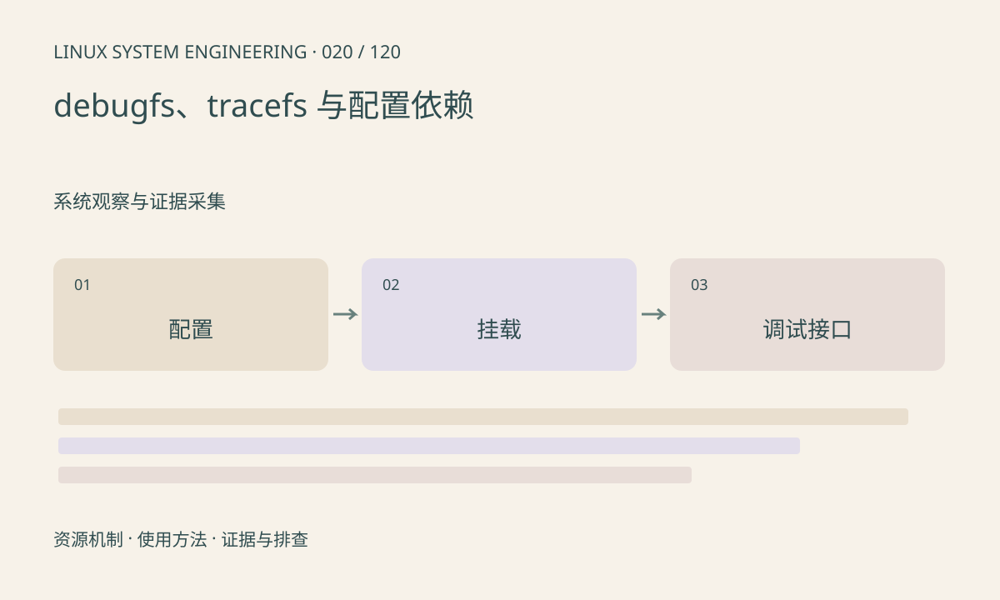

> 第 20 / 120 课 · 系统观察与证据采集。返回[课程合集](/series/embedded-linux-system-engineering/)。

## 机制与资源关系

debugfs 用于调试接口，内容可能随版本变化；tracefs 暴露追踪控制与事件。目录存在不保证文件系统已挂载，挂载成功也不保证目标事件被编入。部分节点可写且影响运行行为。



## 实际用法与观察入口

以下是操作说明；先确认执行环境、工具帮助和目标对象。设备名、PID、地址及项目名示例需要按实际替换，不能将整段命令当通用板端脚本执行。

```sh
cat /proc/filesystems
cat /proc/mounts
ls /sys/kernel/debug
ls /sys/kernel/tracing
```

## 输出解读与排查顺序

按“内核配置→挂载→权限→具体事件”检查。本文仅查看已有挂载，不自动开启追踪或挂载。生产系统的接口可能被禁用，替代方案是日志、用户态时间戳或测试固件。

### 情境推演

/sys/kernel/debug 是空目录，可能尚未挂载，也可能没有所需接口。先查 /proc/mounts，再查内核配置和权限。在没有挂载权限的容器里，不应把宿主功能判为关闭。

## 练习与参考分析

记录目标板是否存在 tracefs、sched 事件及访问权限。参考结论：没有 trace_pipe 不能直接推断内核没有调度器。

本课练习属于阅读、分析或板端观察。未在目标开发板执行，记录时应写明板型、内核配置、工具版本和原始输出。

## 官方资料与版本边界

- [本课参考资料](https://docs.kernel.org/trace/ftrace.html)

内核、工具和厂商 BSP 的支持范围需分别核对。参考资料可能对应较新版本；不要据此推定旧 BSP 支持所有接口。

[上一课：设备节点、设备号与动态管理](/posts/linux-sys-019.html) · [下一课：内核日志、用户日志与时间线](/posts/linux-sys-021.html)
