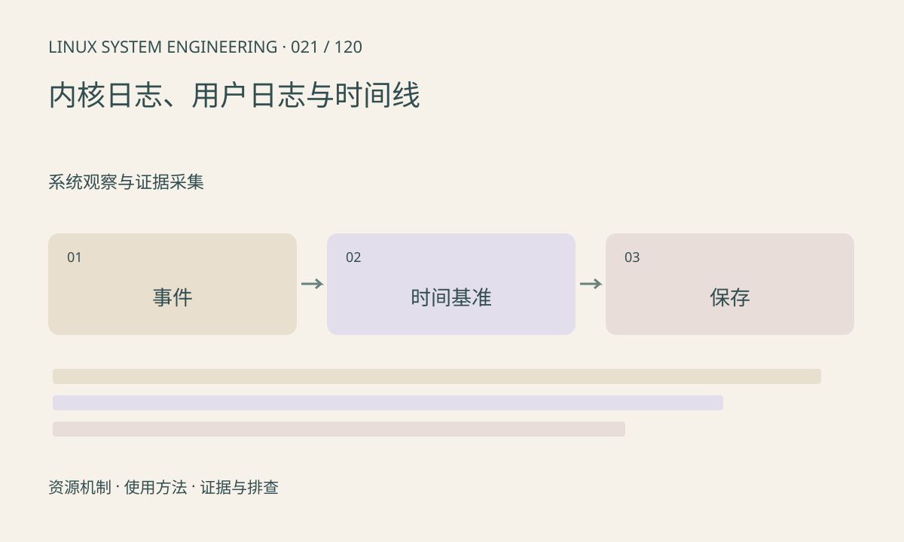

> 第 21 / 120 课 · 系统观察与证据采集。返回[课程合集](/series/embedded-linux-system-engineering/)。

## 机制与资源关系

dmesg 读取内核环形日志，容量有限且可覆盖；用户程序 stderr 不会自动成为内核日志。syslog 和 journal 的采集、持久化策略也不同。关联日志前先确认时间基准、启动编号和时区。



## 实际用法与观察入口

以下是操作说明；先确认执行环境、工具帮助和目标对象。设备名、PID、地址及项目名示例需要按实际替换，不能将整段命令当通用板端脚本执行。

```sh
dmesg
cat /proc/uptime
# 仅 systemd journal 可用时
journalctl -b -k --no-pager
```

## 输出解读与排查顺序

读取受限应记录权限原因，不要为了查看日志直接关闭系统策略。故障发生前的警告往往比最后一条报错重要；避免在中断热路径疯狂打印改变时序。

### 情境推演

应用日志用本地时间，内核日志用启动后秒数，直接按显示时间排序会错位。保存同一时刻的墙上时间与 uptime 作为近似锚点，并注明校时和挂起对换算的影响。

## 练习与参考分析

把一次应用超时与内核错误按相对启动时间对齐。参考结论：两个日志时间接近仅提示相关性，还需通过复现或状态证据验证因果。

本课练习属于阅读、分析或板端观察。未在目标开发板执行，记录时应写明板型、内核配置、工具版本和原始输出。

## 官方资料与版本边界

- [本课参考资料](https://man7.org/linux/man-pages/man1/dmesg.1.html)

内核、工具和厂商 BSP 的支持范围需分别核对。参考资料可能对应较新版本；不要据此推定旧 BSP 支持所有接口。

[上一课：debugfs、tracefs 与配置依赖](/posts/linux-sys-020.html) · [下一课：uptime、负载与基础状态](/posts/linux-sys-022.html)
