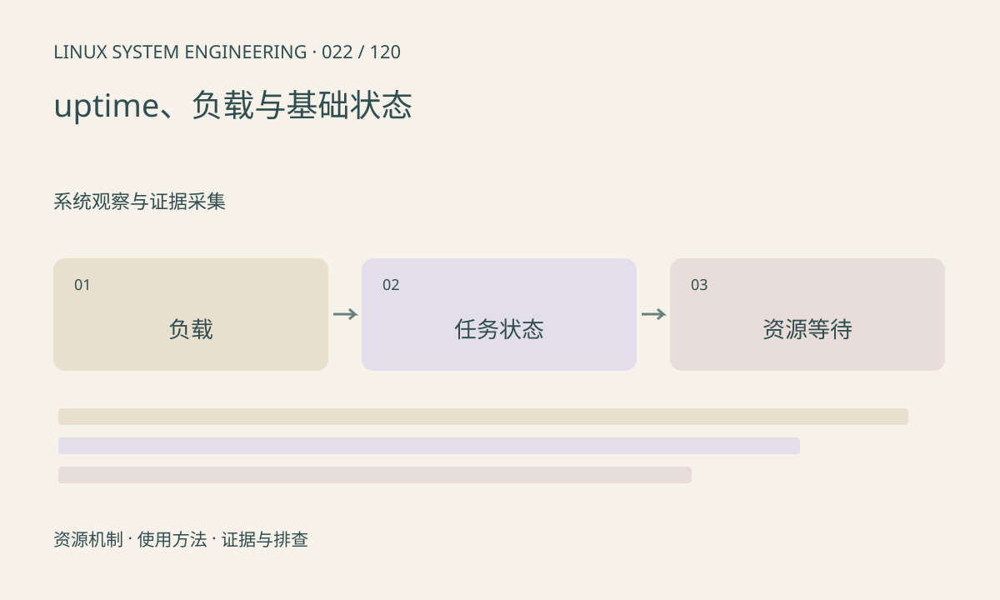

> 第 22 / 120 课 · 系统观察与证据采集。返回[课程合集](/series/embedded-linux-system-engineering/)。

## 机制与资源关系

load average 反映可运行任务及某些不可中断等待任务的平均数量，不是 CPU 百分比。高负载可能伴随低 CPU 使用，例如大量任务等待 I/O。多核系统还需结合核数、亲和性和配额解释。



## 实际用法与观察入口

以下是操作说明；先确认执行环境、工具帮助和目标对象。设备名、PID、地址及项目名示例需要按实际替换，不能将整段命令当通用板端脚本执行。

```sh
cat /proc/loadavg
cat /proc/uptime
cat /proc/stat
# 安装了对应工具时
vmstat 1 3
```

## 输出解读与排查顺序

vmstat 第一行常含启动以来平均值，后续才体现采样区间。把 runnable、blocked、CPU 时间和 I/O 指标放在同一窗口观察，不能靠一个平均值判断瓶颈。

### 情境推演

单核被亲和性限制的线程占满该核，整机 8 核平均利用率仍可能只有约 12.5%。先看线程允许 CPU 集合和每核数据，不能因总体空闲高否定 CPU 瓶颈。

## 练习与参考分析

分析“load 8、CPU idle 80%”的可能路径。参考结论：先检查等待任务和 I/O，不应立即扩 CPU；也要排除容器配额或单核亲和性限制。

本课练习属于阅读、分析或板端观察。未在目标开发板执行，记录时应写明板型、内核配置、工具版本和原始输出。

## 官方资料与版本边界

- [本课参考资料](https://man7.org/linux/man-pages/man5/proc_loadavg.5.html)

内核、工具和厂商 BSP 的支持范围需分别核对。参考资料可能对应较新版本；不要据此推定旧 BSP 支持所有接口。

[上一课：内核日志、用户日志与时间线](/posts/linux-sys-021.html) · [下一课：系统快照与版本对照](/posts/linux-sys-023.html)
