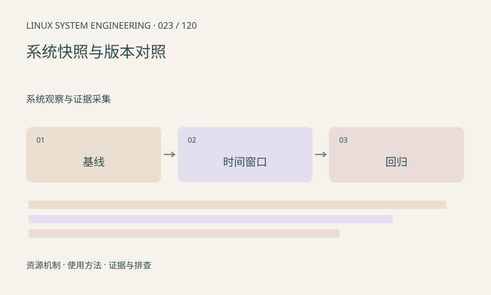

> 第 23 / 120 课 · 系统观察与证据采集。返回[课程合集](/series/embedded-linux-system-engineering/)。

## 机制与资源关系

快照应同时记录环境和事件窗口。单次 free、top 截图无法展示增长趋势；比较不同固件时必须固定输入、运行时长和采样方式。计数器重启或溢出也会影响差值。



## 实际用法与观察入口

以下是操作说明；先确认执行环境、工具帮助和目标对象。设备名、PID、地址及项目名示例需要按实际替换，不能将整段命令当通用板端脚本执行。

```sh
date -u
cat /proc/uptime
cat /proc/meminfo
cat /proc/interrupts
cat /proc/net/dev
```

## 输出解读与排查顺序

把累计计数转成每秒增量，并记录采样间隔。应用帧率、延迟、温度、内存要对齐时间。配置和日志可保存在同一报告目录，但不能采集完整环境变量后无审查上传。

### 情境推演

正常版本运行 1 分钟，异常版本运行 24 小时，内存差异混入了运行时长。改成相同输入、相同预热和采样窗口，再比较增长斜率与稳态水平。

## 练习与参考分析

给正常版和异常版各设计三个相同窗口。参考结论：只在异常版开大量日志会引入额外变量，应说明观测开销并尽量保持方法一致。

本课练习属于阅读、分析或板端观察。未在目标开发板执行，记录时应写明板型、内核配置、工具版本和原始输出。

## 官方资料与版本边界

- [本课参考资料](https://docs.kernel.org/admin-guide/reporting-regressions.html)

内核、工具和厂商 BSP 的支持范围需分别核对。参考资料可能对应较新版本；不要据此推定旧 BSP 支持所有接口。

[上一课：uptime、负载与基础状态](/posts/linux-sys-022.html) · [下一课：工具、权限和内核能力的辨别](/posts/linux-sys-024.html)
