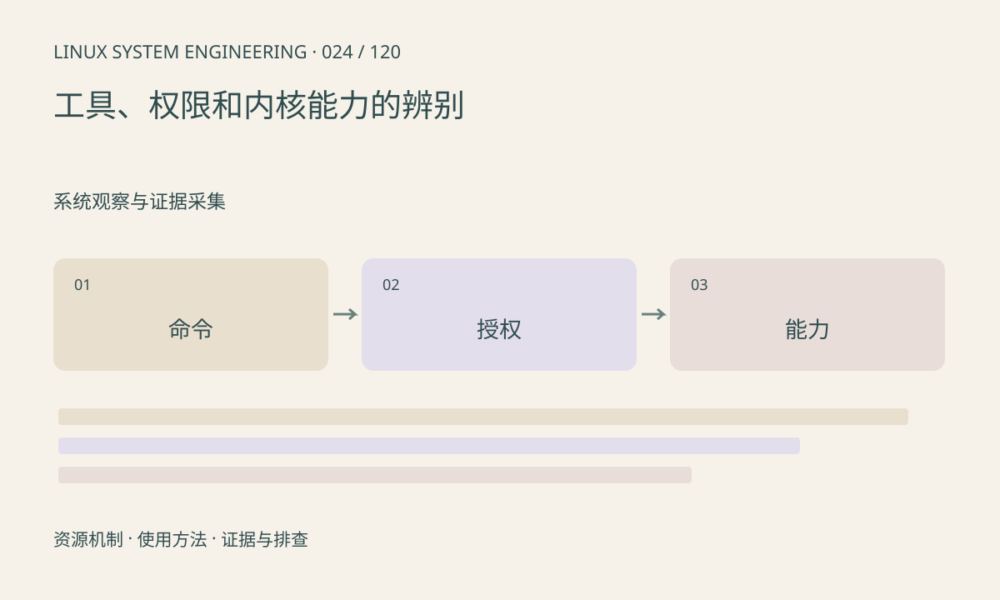

> 第 24 / 120 课 · 系统观察与证据采集。返回[课程合集](/series/embedded-linux-system-engineering/)。

## 机制与资源关系

一条命令失败可能发生在 Shell 找命令、工具解析参数、系统调用授权或内核实现四个层次。ENOENT、EACCES、EPERM、ENOSYS 和 EOPNOTSUPP 指向不同问题，不能都翻译成“不支持 Linux”。



## 实际用法与观察入口

以下是操作说明；先确认执行环境、工具帮助和目标对象。设备名、PID、地址及项目名示例需要按实际替换，不能将整段命令当通用板端脚本执行。

```sh
command -v strace
id
cat /proc/self/status
cat /proc/filesystems
```

## 输出解读与排查顺序

先保存命令、错误文本和退出码，再查能力。容器中的 root 可能没有目标 capability，安全策略也可限制操作。工具缺失可交叉编译；内核功能缺失通常需要换配置并重新构建。

### 情境推演

perf 存在但返回 Operation not permitted，与 command not found 是两类问题。先查 perf_event_paranoid、权限和容器策略，记录限制；不应把采样失败解释成程序没有热点。

## 练习与参考分析

把 command not found、invalid option、Operation not permitted 分到对应层。参考结论：先修正工具或权限问题，再判断被测功能，不能将失败输出当测量值。

本课练习属于阅读、分析或板端观察。未在目标开发板执行，记录时应写明板型、内核配置、工具版本和原始输出。

## 官方资料与版本边界

- [本课参考资料](https://man7.org/linux/man-pages/man7/capabilities.7.html)

内核、工具和厂商 BSP 的支持范围需分别核对。参考资料可能对应较新版本；不要据此推定旧 BSP 支持所有接口。

[上一课：系统快照与版本对照](/posts/linux-sys-023.html) · [下一课：进程生命周期与状态](/posts/linux-sys-025.html)
