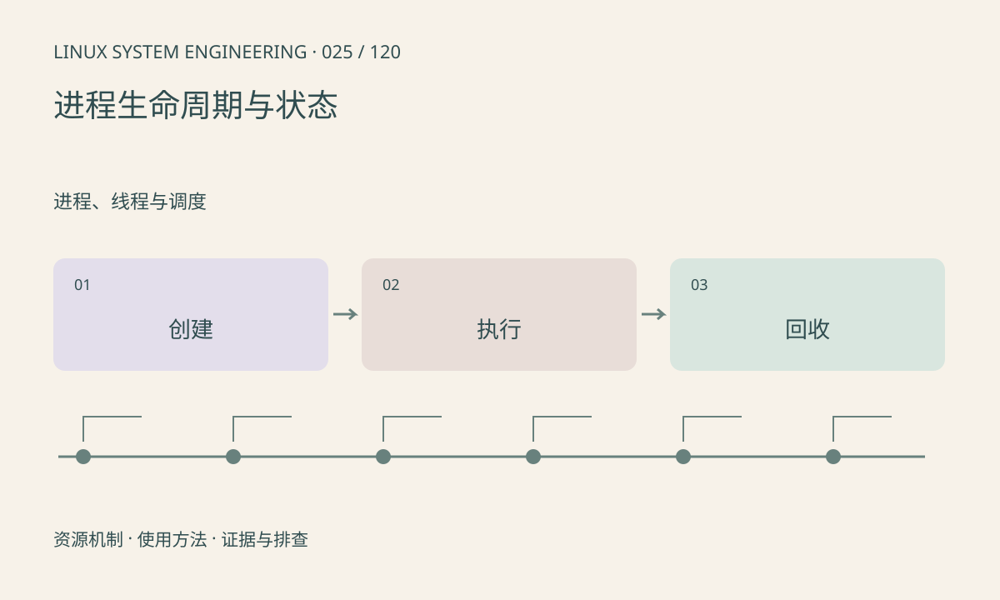

> 第 25 / 120 课 · 进程、线程与调度。返回[课程合集](/series/embedded-linux-system-engineering/)。

## 机制与资源关系

fork 创建子进程，exec 替换当前进程映像，wait 回收子进程状态。PID 相同不表示程序没有变化；exec 成功后不会返回原调用点。R、S、D、T、Z 描述调度或生命周期状态，不直接给出业务故障原因。



## 实际用法与观察入口

以下是操作说明；先确认执行环境、工具帮助和目标对象。设备名、PID、地址及项目名示例需要按实际替换，不能将整段命令当通用板端脚本执行。

```sh
cat /proc/self/status
ps
# procps 完整工具可用时
ps -eo pid,ppid,stat,comm
```

## 输出解读与排查顺序

先区分进程不存在、正常等待、不可中断等待和停止。记录状态变化及父进程，避免只凭一次 S 状态判断卡死。配套实验创建一个退出码明确的子进程并回收。

### 情境推演

父进程用 waitpid 得到的是子进程 PID，真正退出原因在 status 中。WIFEXITED 为真才能读取 WEXITSTATUS；被信号终止时应按 WIFSIGNALED 分支解释，避免把编码后的状态误当业务返回值。

## 练习与参考分析

运行 fork/wait 示例，观察父进程取得退出码 7。参考结论：退出状态由父进程通过 wait 系列接口读取，不能直接把 wait 返回值当退出码。

### 独立实验包

主机 Linux 的有界 C 实验；不访问真实外设，不代表板端时序或性能。 默认入口、源文件和实际运行记录都在下载包中。

```experiment
practice
```

## 官方资料与版本边界

- [本课参考资料](https://man7.org/linux/man-pages/man2/waitpid.2.html)

内核、工具和厂商 BSP 的支持范围需分别核对。参考资料可能对应较新版本；不要据此推定旧 BSP 支持所有接口。

[上一课：工具、权限和内核能力的辨别](/posts/linux-sys-024.html) · [下一课：线程、TID 与共享资源](/posts/linux-sys-026.html)
