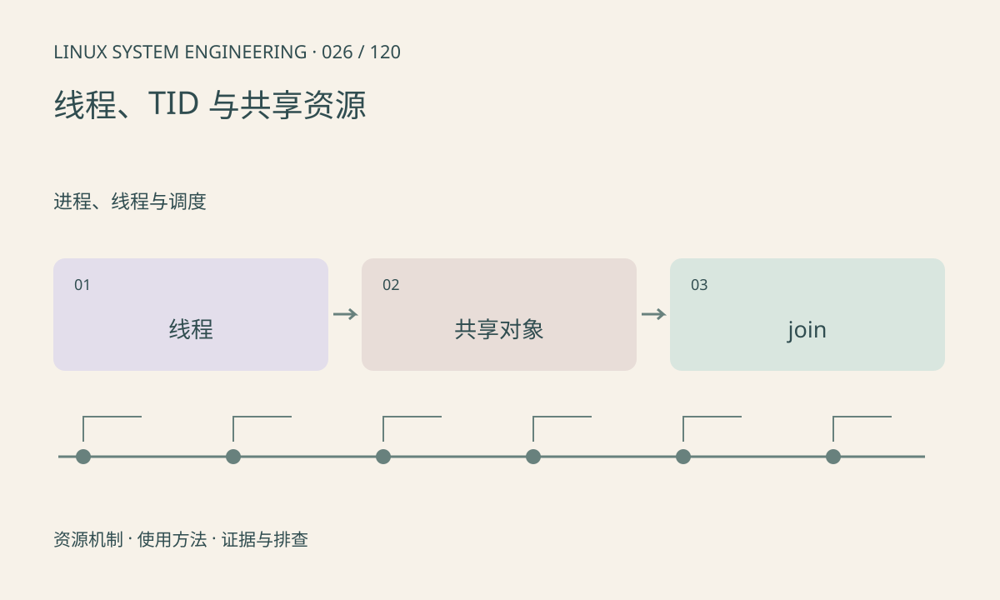

> 第 26 / 120 课 · 进程、线程与调度。返回[课程合集](/series/embedded-linux-system-engineering/)。

## 机制与资源关系

同一进程的线程共享地址空间和通常的文件描述符表，但有自己的栈、调度状态和线程 ID。一个线程阻塞不代表其他线程停止。线程数增长也消耗栈映射与内核资源，不能只看堆。



## 实际用法与观察入口

以下是操作说明；先确认执行环境、工具帮助和目标对象。设备名、PID、地址及项目名示例需要按实际替换，不能将整段命令当通用板端脚本执行。

```sh
# 使用当前 Shell 的进程作为安全观察对象
ls /proc/$$/task
cat /proc/$$/status
# 完整 procps：替换为业务 PID
ps -L -p 1234 -o pid,tid,stat,comm
```

## 输出解读与排查顺序

按 TID 找热点和等待点，再映射到应用线程名。pthread_t 不是可移植的 Linux TID；日志应明确记录哪种标识。读取其他进程可能受权限影响。

### 情境推演

主线程把局部变量地址传给工作线程后立即返回，线程随后访问已经失效的栈。修复要延长对象生命周期或使用明确所有权，不是简单给指针加 volatile。

## 练习与参考分析

运行本课线程示例，两个线程各更新独立计数并由主线程 join。参考结论：join 后才能安全读取结果并结束生命周期，不要让线程引用已销毁的栈对象。

### 独立实验包

主机 Linux 的有界 C 实验；不访问真实外设，不代表板端时序或性能。 默认入口、源文件和实际运行记录都在下载包中。

```experiment
practice
```

## 官方资料与版本边界

- [本课参考资料](https://man7.org/linux/man-pages/man7/pthreads.7.html)

内核、工具和厂商 BSP 的支持范围需分别核对。参考资料可能对应较新版本；不要据此推定旧 BSP 支持所有接口。

[上一课：进程生命周期与状态](/posts/linux-sys-025.html) · [下一课：调度策略、nice 与实时优先级](/posts/linux-sys-027.html)
