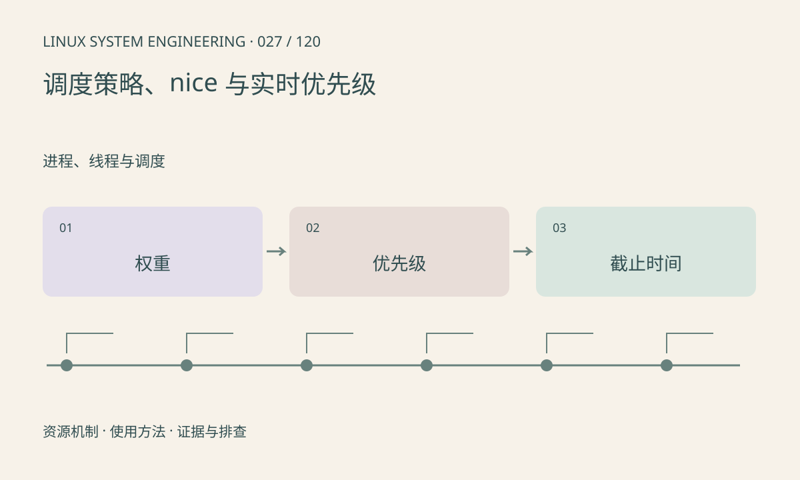

> 第 27 / 120 课 · 进程、线程与调度。返回[课程合集](/series/embedded-linux-system-engineering/)。

## 机制与资源关系

nice 影响普通调度任务的相对权重，不能保证截止时间。SCHED_FIFO、SCHED_RR 属于实时调度策略；错误配置可能饿死普通任务。权限、资源限制及 cgroup 都可能约束设置结果。



## 实际用法与观察入口

以下是操作说明；先确认执行环境、工具帮助和目标对象。设备名、PID、地址及项目名示例需要按实际替换，不能将整段命令当通用板端脚本执行。

```sh
# 查询当前 Shell，不修改策略
chrt -p $$
ps -o pid,ni,cls,comm -p $$
cat /proc/$$/limits
```

## 输出解读与排查顺序

提高优先级前先证明确实等待 CPU。若瓶颈是设备完成、互斥锁或 I/O，提高线程优先级并不消除阻塞。记录线程级策略，不能只看进程名称。

### 情境推演

日志线程持有采集需要的锁并执行慢速写盘，即使采集设高优先级也可能等待。先缩短临界区或把写入移到锁外，再评估策略，不能只提升优先级。

## 练习与参考分析

为采集、推理、日志三个线程安排优先关系并说明阻塞点。参考结论：实时线程中的无界循环和无界锁等待会破坏系统可用性，应先设计有界工作。

本课练习属于阅读、分析或板端观察。未在目标开发板执行，记录时应写明板型、内核配置、工具版本和原始输出。

## 官方资料与版本边界

- [本课参考资料](https://man7.org/linux/man-pages/man7/sched.7.html)

内核、工具和厂商 BSP 的支持范围需分别核对。参考资料可能对应较新版本；不要据此推定旧 BSP 支持所有接口。

[上一课：线程、TID 与共享资源](/posts/linux-sys-026.html) · [下一课：CPU 亲和性与多核](/posts/linux-sys-028.html)
