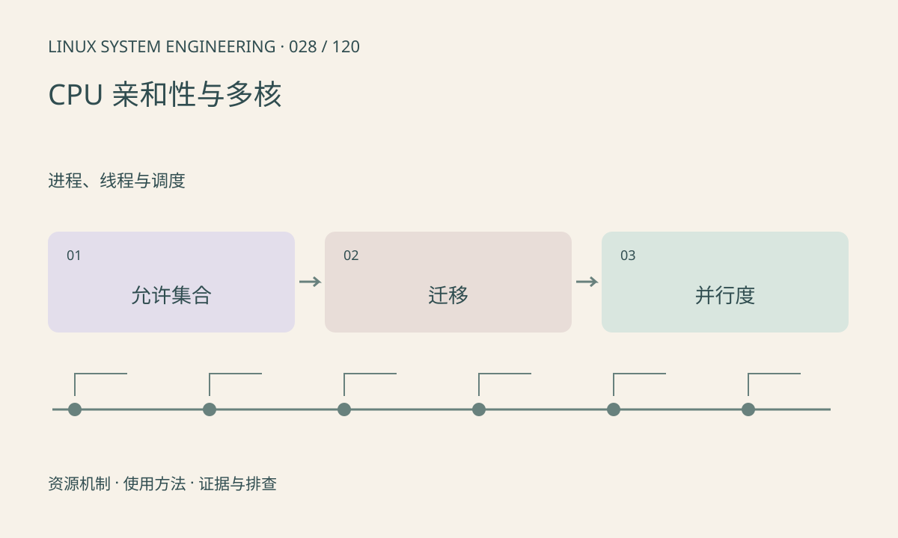

> 第 28 / 120 课 · 进程、线程与调度。返回[课程合集](/series/embedded-linux-system-engineering/)。

## 机制与资源关系

亲和性约束线程可运行的 CPU 集合，不是独占 CPU，也不会自动搬走中断。线程允许 CPU 集合还受 cpuset 和在线 CPU 状态影响。把所有线程绑到一核可能降低迁移，却增加排队。



## 实际用法与观察入口

以下是操作说明；先确认执行环境、工具帮助和目标对象。设备名、PID、地址及项目名示例需要按实际替换，不能将整段命令当通用板端脚本执行。

```sh
cat /sys/devices/system/cpu/online
cat /proc/self/status
taskset -pc $$
```

## 输出解读与排查顺序

检查 Cpus_allowed_list 与实际配置。性能比较要固定负载，分别观察迁移、缓存、IRQ 和尾延迟；单次平均速度提高不足以证明绑核方案可靠。

### 情境推演

两个每帧各需 20ms 的阶段都绑到同一核，30fps 时合计 CPU 预算至少 40ms/帧，超过约 33.3ms 周期。若无法重叠或降低工作量，绑核会造成积压。

## 练习与参考分析

画两条共享队列线程在同核与异核下的数据路径。参考结论：局部性与并行度存在取舍，不能按“核越多越快”直接设置。

本课练习属于阅读、分析或板端观察。未在目标开发板执行，记录时应写明板型、内核配置、工具版本和原始输出。

## 官方资料与版本边界

- [本课参考资料](https://man7.org/linux/man-pages/man2/sched_setaffinity.2.html)

内核、工具和厂商 BSP 的支持范围需分别核对。参考资料可能对应较新版本；不要据此推定旧 BSP 支持所有接口。

[上一课：调度策略、nice 与实时优先级](/posts/linux-sys-027.html) · [下一课：上下文切换、抢占与唤醒延迟](/posts/linux-sys-029.html)
