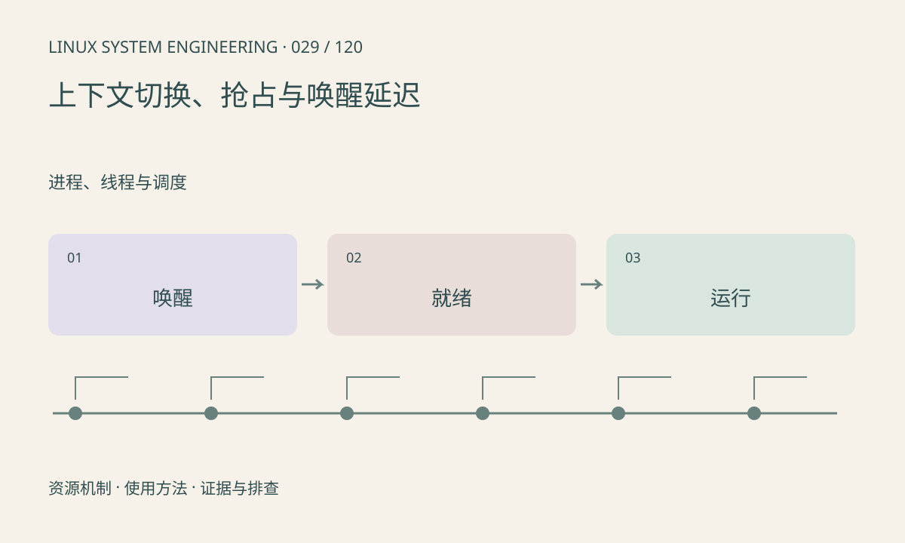

> 第 29 / 120 课 · 进程、线程与调度。返回[课程合集](/series/embedded-linux-system-engineering/)。

## 机制与资源关系

线程从等待变为可运行，到真正获得 CPU 之间存在调度延迟。主动等待与被抢占产生不同类型的上下文切换计数；计数多并不必然有问题，必须结合单位业务成本。



## 实际用法与观察入口

以下是操作说明；先确认执行环境、工具帮助和目标对象。设备名、PID、地址及项目名示例需要按实际替换，不能将整段命令当通用板端脚本执行。

```sh
cat /proc/self/status
cat /proc/stat
# 安装 sysstat 时
pidstat -w 1 3
```

## 输出解读与排查顺序

区分等待资源的时间和已就绪却未运行的时间。使用调度事件追踪可以关联 wakeup 与 switch，但需确认时间源和丢事件情况。不要把全部端到端延迟归给调度器。

### 情境推演

假设事件在 100ms 到达、线程 104ms 才获得 CPU、110ms 完成。可分出 4ms 就绪等待和 6ms 执行，不能把 10ms 全归为算法；还需确认事件时间戳采集的位置。

## 练习与参考分析

将 30ms 总延迟拆成 20ms 等数据、3ms 等 CPU、7ms 执行。参考结论：即使消除调度等待，下界仍为 27ms，应优先处理更大的延迟段。

本课练习属于阅读、分析或板端观察。未在目标开发板执行，记录时应写明板型、内核配置、工具版本和原始输出。

## 官方资料与版本边界

- [本课参考资料](https://docs.kernel.org/scheduler/sched-stats.html)

内核、工具和厂商 BSP 的支持范围需分别核对。参考资料可能对应较新版本；不要据此推定旧 BSP 支持所有接口。

[上一课：CPU 亲和性与多核](/posts/linux-sys-028.html) · [下一课：信号与有序退出](/posts/linux-sys-030.html)
