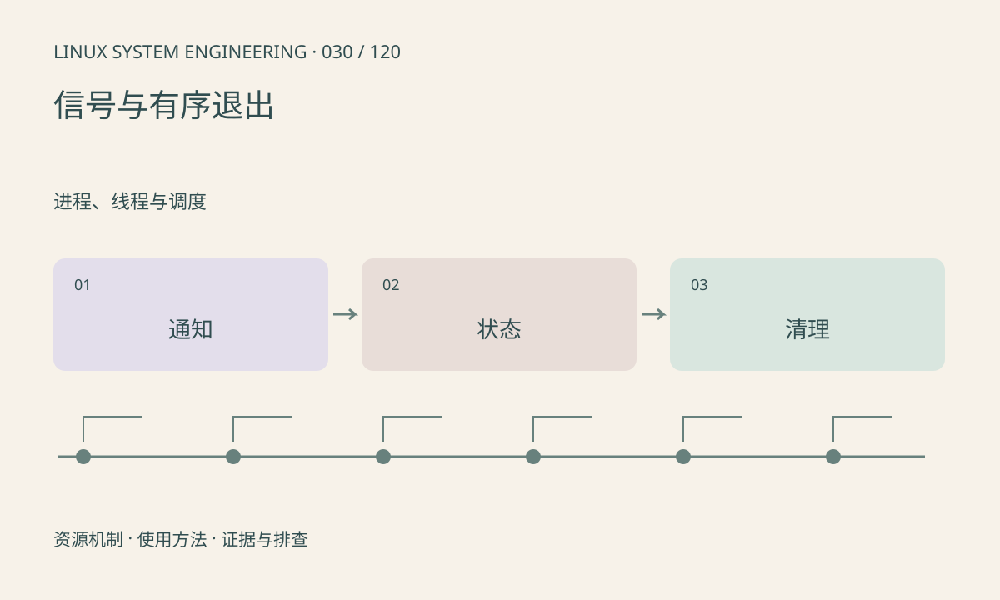

> 第 30 / 120 课 · 进程、线程与调度。返回[课程合集](/series/embedded-linux-system-engineering/)。

## 机制与资源关系

信号处理函数会打断正常控制流，只能调用异步信号安全的操作。常用做法是处理函数设置 sig_atomic_t 标志，主循环退出后统一释放资源；多线程程序还需设计信号屏蔽和接收线程。



## 实际用法与观察入口

以下是操作说明；先确认执行环境、工具帮助和目标对象。设备名、PID、地址及项目名示例需要按实际替换，不能将整段命令当通用板端脚本执行。

```sh
kill -l
cat /proc/self/status
```

## 输出解读与排查顺序

SIGTERM 可以请求退出，SIGKILL 不允许程序清理。系统调用可能因 EINTR 返回，也可能按接口与配置自动重启；应逐个检查返回值。避免在处理函数里 printf、malloc 或加普通锁。

### 情境推演

处理 SIGTERM 时直接释放仍被工作线程使用的缓冲会造成释放后使用。处理函数只通知退出，主流程停止提交、唤醒等待、join 后再释放，顺序比“尽快退出”更重要。

## 练习与参考分析

运行仅给自身发送 SIGUSR1 的实验。参考结论：信号用于通知状态变化，不应默认普通信号会按发送次数逐一排队。

### 独立实验包

主机 Linux 的有界 C 实验；不访问真实外设，不代表板端时序或性能。 默认入口、源文件和实际运行记录都在下载包中。

```experiment
practice
```

## 官方资料与版本边界

- [本课参考资料](https://man7.org/linux/man-pages/man7/signal-safety.7.html)

内核、工具和厂商 BSP 的支持范围需分别核对。参考资料可能对应较新版本；不要据此推定旧 BSP 支持所有接口。

[上一课：上下文切换、抢占与唤醒延迟](/posts/linux-sys-029.html) · [下一课：僵尸进程与子进程回收](/posts/linux-sys-031.html)
