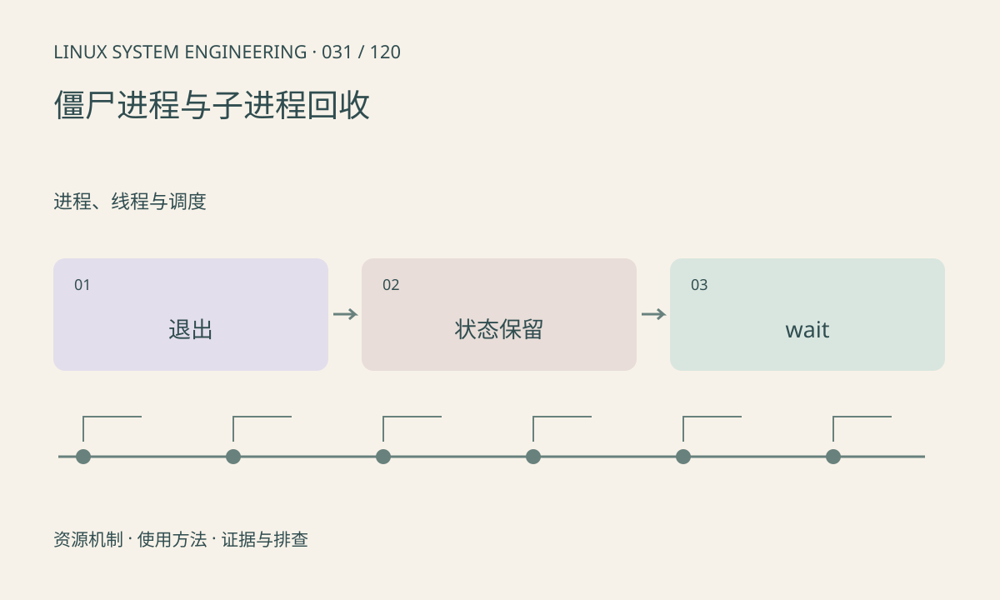

> 第 31 / 120 课 · 进程、线程与调度。返回[课程合集](/series/embedded-linux-system-engineering/)。

## 机制与资源关系

子进程退出后保留供父进程读取的状态，父进程未 wait 会出现僵尸。僵尸通常不再执行代码，但会占据进程表资源。孤儿进程则描述父子关系变化，与僵尸不是同义词。



## 实际用法与观察入口

以下是操作说明；先确认执行环境、工具帮助和目标对象。设备名、PID、地址及项目名示例需要按实际替换，不能将整段命令当通用板端脚本执行。

```sh
ps
# 完整 procps 可用时
ps -eo pid,ppid,stat,comm
cat /proc/1/status
```

## 输出解读与排查顺序

Z 状态不能靠再次 kill 子进程回收，应修复父进程回收逻辑。容器中的 PID 1 或 subreaper 也影响接管关系；不要默认所有孤儿都由宿主机 PID 1 直接接管。

### 情境推演

程序每次启动子工具都不回收，长期出现越来越多 Z 状态。修复父进程的 wait 逻辑，并处理所有退出分支。给僵尸发 SIGKILL 不会替父进程读取退出状态。

## 练习与参考分析

查看本课实验中“子进程已退出→父进程 wait”的状态转换。参考结论：所有成功创建的子进程都应有回收路径，包括业务失败和提前退出分支。

### 独立实验包

主机 Linux 的有界 C 实验；不访问真实外设，不代表板端时序或性能。 默认入口、源文件和实际运行记录都在下载包中。

```experiment
practice
```

## 官方资料与版本边界

- [本课参考资料](https://man7.org/linux/man-pages/man2/wait.2.html)

内核、工具和厂商 BSP 的支持范围需分别核对。参考资料可能对应较新版本；不要据此推定旧 BSP 支持所有接口。

[上一课：信号与有序退出](/posts/linux-sys-030.html) · [下一课：高 CPU、低 CPU 卡顿与 D 状态](/posts/linux-sys-032.html)
