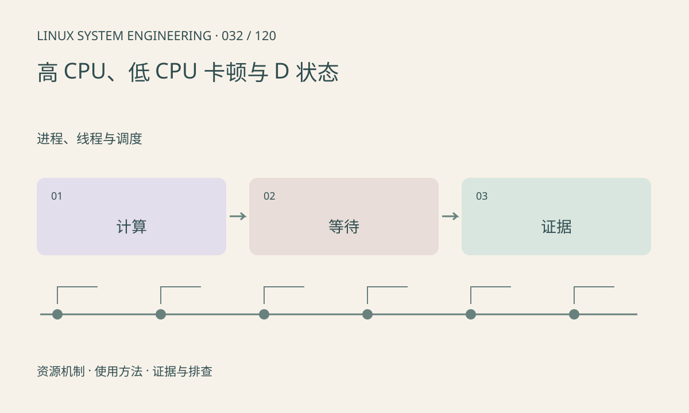

> 第 32 / 120 课 · 进程、线程与调度。返回[课程合集](/series/embedded-linux-system-engineering/)。

## 机制与资源关系

高 CPU 可能是有效计算、忙轮询或异常重试；低 CPU 卡顿可能等待锁、事件、I/O 或配额。D 状态表示某类不可中断等待，常见于 I/O，但不能直接等同于磁盘坏了。



## 实际用法与观察入口

以下是操作说明；先确认执行环境、工具帮助和目标对象。设备名、PID、地址及项目名示例需要按实际替换，不能将整段命令当通用板端脚本执行。

```sh
top
cat /proc/loadavg
# 替换为目标 PID；可能需要额外权限
cat /proc/1234/wchan
cat /proc/1234/stack
```

## 输出解读与排查顺序

先按线程分类，再采样用户栈、系统调用或内核栈。wchan 只是一处等待线索，符号可能被隐藏。重复采样同一位置并结合相关设备计数，才能缩小原因。

### 情境推演

线程 CPU 接近零、反复停在 futex，先查看它等待的条件和生产者进展。仅凭 futex 不能确定死锁，也可能是合法空队列；结合业务期望、其他线程栈和通知记录判断。

## 练习与参考分析

比较“死循环”“等条件变量”“等设备完成”三种症状。参考结论：对等待线程使用 CPU 火焰图可能看不到根因，需要阻塞时长与唤醒证据。

本课练习属于阅读、分析或板端观察。未在目标开发板执行，记录时应写明板型、内核配置、工具版本和原始输出。

## 官方资料与版本边界

- [本课参考资料](https://man7.org/linux/man-pages/man5/proc_pid_wchan.5.html)

内核、工具和厂商 BSP 的支持范围需分别核对。参考资料可能对应较新版本；不要据此推定旧 BSP 支持所有接口。

[上一课：僵尸进程与子进程回收](/posts/linux-sys-031.html) · [下一课：虚拟地址、物理内存与映射](/posts/linux-sys-033.html)
