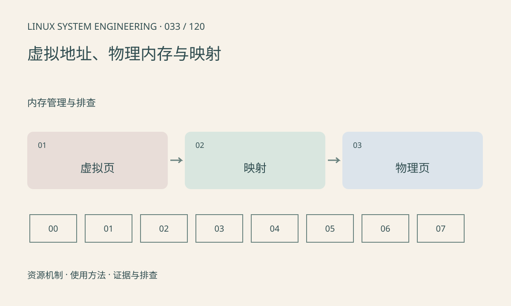

> 第 33 / 120 课 · 内存管理与排查。返回[课程合集](/series/embedded-linux-system-engineering/)。

## 机制与资源关系

进程地址空间通过页表映射到物理页，映射可以按需建立，虚拟连续不保证物理连续。CPU 虚拟地址也不等于设备 DMA 地址。共享映射使不同进程看到同一底层对象，但生命周期仍需协议管理。



## 实际用法与观察入口

以下是操作说明；先确认执行环境、工具帮助和目标对象。设备名、PID、地址及项目名示例需要按实际替换，不能将整段命令当通用板端脚本执行。

```sh
cat /proc/self/maps
cat /proc/self/status
getconf PAGESIZE
```

## 输出解读与排查顺序

maps 展示地址范围、权限、偏移和对象，不能直接算出真实物理占用。不要把指针传给硬件当物理地址，也不要在用户态通过猜测地址替代驱动 DMA API。

### 情境推演

mmap 申请 1GiB 地址范围后 RSS 只小幅增加，并不反常：尚未触碰的页可能未全部驻留。逐页写入会改变占用；实验必须限定规模，不能在小内存板上照搬 1GiB。

## 练习与参考分析

标出可执行文件、共享库、栈和匿名映射。参考结论：两个进程相同虚拟地址可能映射不同物理页，虚拟地址数值不能跨进程直接使用。

本课练习属于阅读、分析或板端观察。未在目标开发板执行，记录时应写明板型、内核配置、工具版本和原始输出。

## 官方资料与版本边界

- [本课参考资料](https://man7.org/linux/man-pages/man5/proc_pid_maps.5.html)

内核、工具和厂商 BSP 的支持范围需分别核对。参考资料可能对应较新版本；不要据此推定旧 BSP 支持所有接口。

[上一课：高 CPU、低 CPU 卡顿与 D 状态](/posts/linux-sys-032.html) · [下一课：栈、堆、malloc 与 mmap](/posts/linux-sys-034.html)
