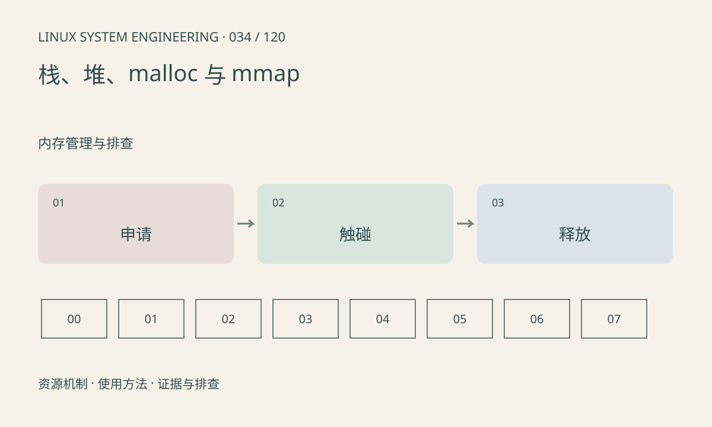

> 第 34 / 120 课 · 内存管理与排查。返回[课程合集](/series/embedded-linux-system-engineering/)。

## 机制与资源关系

malloc 管理用户态分配，可能从堆或匿名映射取得空间；free 将内存归还分配器，不保证立即还给内核。栈受线程属性和资源限制约束，大数组放栈上可能快速耗尽空间。



## 实际用法与观察入口

以下是操作说明；先确认执行环境、工具帮助和目标对象。设备名、PID、地址及项目名示例需要按实际替换，不能将整段命令当通用板端脚本执行。

```sh
cat /proc/self/limits
cat /proc/self/maps
```

## 输出解读与排查顺序

先区分地址空间增长、驻留页增长和分配器保留。申请但未触碰的内存与逐页写入后的 RSS 可能不同。不能用 free 后 RSS 未下降单独证明泄漏。

### 情境推演

大对象 free 后 RSS 保持高位，但下一轮分配不再增长，可能是分配器复用。对比活跃对象数、重复运行平台期和映射变化，再判断是否丢失释放路径。

## 练习与参考分析

配套实验 mmap 一小块空间、写入并 munmap，检查返回值。参考结论：返回 MAP_FAILED 才表示 mmap 失败，不能只和 NULL 比较。

### 独立实验包

主机 Linux 的有界 C 实验；不访问真实外设，不代表板端时序或性能。 默认入口、源文件和实际运行记录都在下载包中。

```experiment
practice
```

## 官方资料与版本边界

- [本课参考资料](https://man7.org/linux/man-pages/man2/mmap.2.html)

内核、工具和厂商 BSP 的支持范围需分别核对。参考资料可能对应较新版本；不要据此推定旧 BSP 支持所有接口。

[上一课：虚拟地址、物理内存与映射](/posts/linux-sys-033.html) · [下一课：RSS、PSS 与共享内存统计](/posts/linux-sys-035.html)
