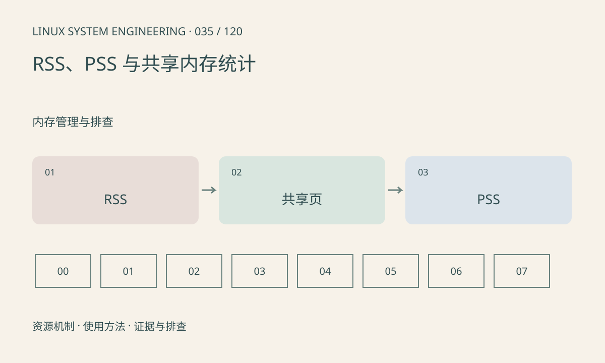

> 第 35 / 120 课 · 内存管理与排查。返回[课程合集](/series/embedded-linux-system-engineering/)。

## 机制与资源关系

RSS 统计驻留页，共享页可能同时计入多个进程；PSS 将共享页按映射者分摊，适合估算进程群的份额。VmSize 是虚拟范围，不能拿它直接和物理 RAM 容量比较。



## 实际用法与观察入口

以下是操作说明；先确认执行环境、工具帮助和目标对象。设备名、PID、地址及项目名示例需要按实际替换，不能将整段命令当通用板端脚本执行。

```sh
cat /proc/self/status
# 取决于内核和权限
cat /proc/self/smaps_rollup
```

## 输出解读与排查顺序

从同一采样窗口比较统计口径。RSS 汇总可能重复计算共享库，系统使用量还包括内核和页缓存。smaps 读取有成本，不适合无节制高频遍历所有进程。

### 情境推演

两个进程共享 8MiB 页，分别还拥有 2MiB 私有页。简化情况下 RSS 各 10MiB、合计 20MiB，实际这部分只有 12MiB；共享均分时 PSS 各约 6MiB。

## 练习与参考分析

两个进程各映射同一块 8MB 驻留共享内存，解释为何 RSS 相加可多算。参考结论：PSS 分摊仅描述该时刻份额，不代表退出某进程必定释放同等物理内存。

本课练习属于阅读、分析或板端观察。未在目标开发板执行，记录时应写明板型、内核配置、工具版本和原始输出。

## 官方资料与版本边界

- [本课参考资料](https://man7.org/linux/man-pages/man5/proc_pid_smaps.5.html)

内核、工具和厂商 BSP 的支持范围需分别核对。参考资料可能对应较新版本；不要据此推定旧 BSP 支持所有接口。

[上一课：栈、堆、malloc 与 mmap](/posts/linux-sys-034.html) · [下一课：页缓存、回收、swap 与内存压力](/posts/linux-sys-036.html)
