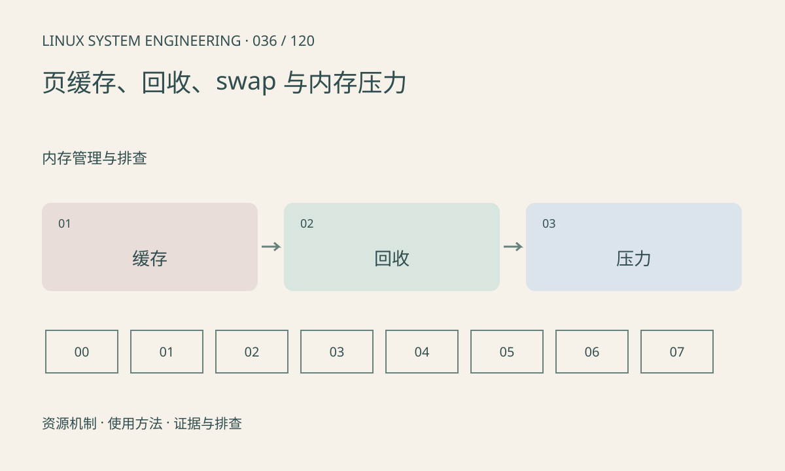

> 第 36 / 120 课 · 内存管理与排查。返回[课程合集](/series/embedded-linux-system-engineering/)。

## 机制与资源关系

Linux 利用空闲内存缓存文件数据，可回收缓存与不可回收占用性质不同。MemAvailable 是可用内存的估计，不能等同于 MemFree。交换、直接回收和脏页写回都可能增加延迟。



## 实际用法与观察入口

以下是操作说明；先确认执行环境、工具帮助和目标对象。设备名、PID、地址及项目名示例需要按实际替换，不能将整段命令当通用板端脚本执行。

```sh
cat /proc/meminfo
cat /proc/vmstat
cat /proc/swaps
# PSI 开启时
cat /proc/pressure/memory
```

## 输出解读与排查顺序

观察回收、缺页和压力增量，再关联业务停顿。不要把 drop_caches 当常规修复：它会改变缓存命中并干扰复现，也不能修复真实泄漏。zram 和 swap 需按板级条件单独设计。

### 情境推演

文件读取后 Cached 增长但业务稳定、内存压力无持续上升，可能只是缓存预热。若随后出现直接回收和长延迟，再检查工作集、脏页和分配行为，而不是定时清缓存。

## 练习与参考分析

分析“空闲少但 available 足、无持续压力”的系统。参考结论：不能仅因 MemFree 低宣判内存不足，应继续看不可回收增长与等待时间。

本课练习属于阅读、分析或板端观察。未在目标开发板执行，记录时应写明板型、内核配置、工具版本和原始输出。

## 官方资料与版本边界

- [本课参考资料](https://docs.kernel.org/admin-guide/mm/concepts.html)

内核、工具和厂商 BSP 的支持范围需分别核对。参考资料可能对应较新版本；不要据此推定旧 BSP 支持所有接口。

[上一课：RSS、PSS 与共享内存统计](/posts/linux-sys-035.html) · [下一课：slab 与内核内存](/posts/linux-sys-037.html)
