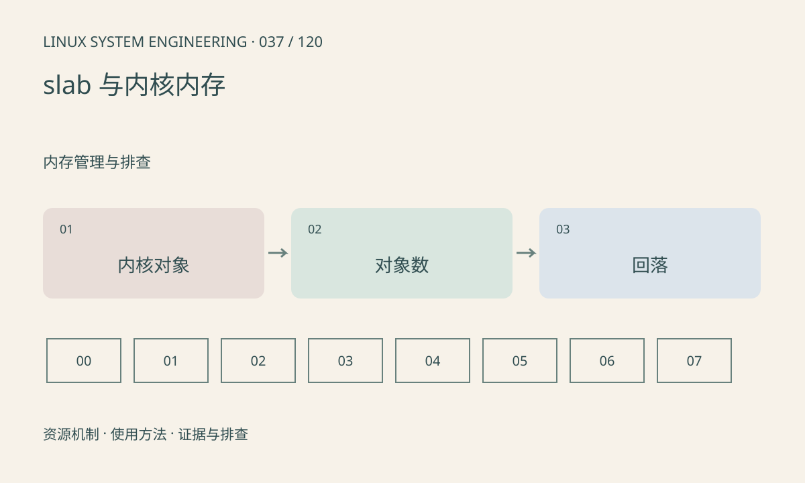

> 第 37 / 120 课 · 内存管理与排查。返回[课程合集](/series/embedded-linux-system-engineering/)。

## 机制与资源关系

内核使用对象缓存管理 inode、dentry 等对象。slab 增长可能是正常缓存，也可能是对象泄漏。用户态 RSS 看不到全部内核分配，进程退出后仍增长的问题需要扩展到内核资源。



## 实际用法与观察入口

以下是操作说明；先确认执行环境、工具帮助和目标对象。设备名、PID、地址及项目名示例需要按实际替换，不能将整段命令当通用板端脚本执行。

```sh
cat /proc/meminfo
# 可能需要权限
cat /proc/slabinfo
command -v slabtop
```

## 输出解读与排查顺序

区分 SReclaimable 与 SUnreclaim，并观察对应对象数随业务循环是否回落。不同分配器和调试配置影响统计；只比较字节总量不足以指出哪个驱动漏了对象。

### 情境推演

每次打开关闭设备后某专用对象数净增一个，重复 100 次仍线性增加，这是比单次 slab 总量更强的泄漏线索。继续追踪错误路径和引用，而不是直接调整 slab 参数。

## 练习与参考分析

设计反复打开关闭设备后的对象计数记录。参考结论：稳定平台上的持续线性增长值得追踪，但缓存预热后的平台期不等同于泄漏。

本课练习属于阅读、分析或板端观察。未在目标开发板执行，记录时应写明板型、内核配置、工具版本和原始输出。

## 官方资料与版本边界

- [本课参考资料](https://man7.org/linux/man-pages/man5/slabinfo.5.html)

内核、工具和厂商 BSP 的支持范围需分别核对。参考资料可能对应较新版本；不要据此推定旧 BSP 支持所有接口。

[上一课：页缓存、回收、swap 与内存压力](/posts/linux-sys-036.html) · [下一课：CMA、保留内存与厂商缓冲池](/posts/linux-sys-038.html)
