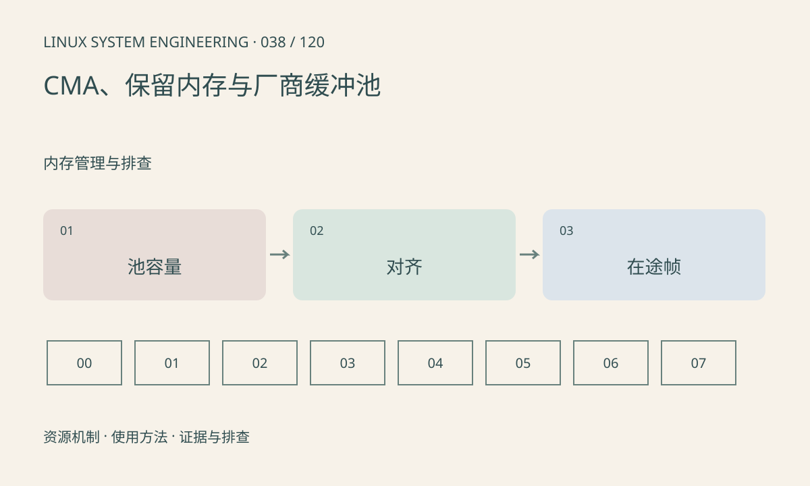

> 第 38 / 120 课 · 内存管理与排查。返回[课程合集](/series/embedded-linux-system-engineering/)。

## 机制与资源关系

CMA 支持某些连续内存分配需求，reserved-memory 则描述保留区域及用途。厂商媒体池可能有独立分区和统计，不能默认全部反映为应用 RSS。dma-buf 共享也不会消除实际物理占用。



## 实际用法与观察入口

以下是操作说明；先确认执行环境、工具帮助和目标对象。设备名、PID、地址及项目名示例需要按实际替换，不能将整段命令当通用板端脚本执行。

```sh
cat /proc/meminfo
cat /proc/iomem
ls /sys/firmware/devicetree/base/reserved-memory
# 仅在对应调试接口存在时查看目录
ls /sys/kernel/debug/dma_buf
```

## 输出解读与排查顺序

记录申请大小、对齐、池类别和并发缓冲数。CmaFree 大不保证任意请求成功，迁移、碎片、区域选择与硬件限制都可能影响结果。厂商 MMZ/VB 等名称需按 SDK 文档核对。

### 情境推演

NV12 在宽高为偶数时的有效数据量常按 1.5×宽×高估算，但驱动可能要求更大 stride 和 plane 对齐。预算应采用实际协商大小，再乘同时持有帧数并加其他消费者。

## 练习与参考分析

估算 6 个 1920×1080 NV12 缓冲的有效像素约 18.66MB，再加 stride 和对齐。参考结论：还需计算编码、缩放、NPU 中间缓冲，不能只扩大一个池。

本课练习属于阅读、分析或板端观察。未在目标开发板执行，记录时应写明板型、内核配置、工具版本和原始输出。

## 官方资料与版本边界

- [本课参考资料](https://docs.kernel.org/driver-api/dma-buf.html)

内核、工具和厂商 BSP 的支持范围需分别核对。参考资料可能对应较新版本；不要据此推定旧 BSP 支持所有接口。

[上一课：slab 与内核内存](/posts/linux-sys-037.html) · [下一课：OOM、碎片与分配失败](/posts/linux-sys-039.html)
