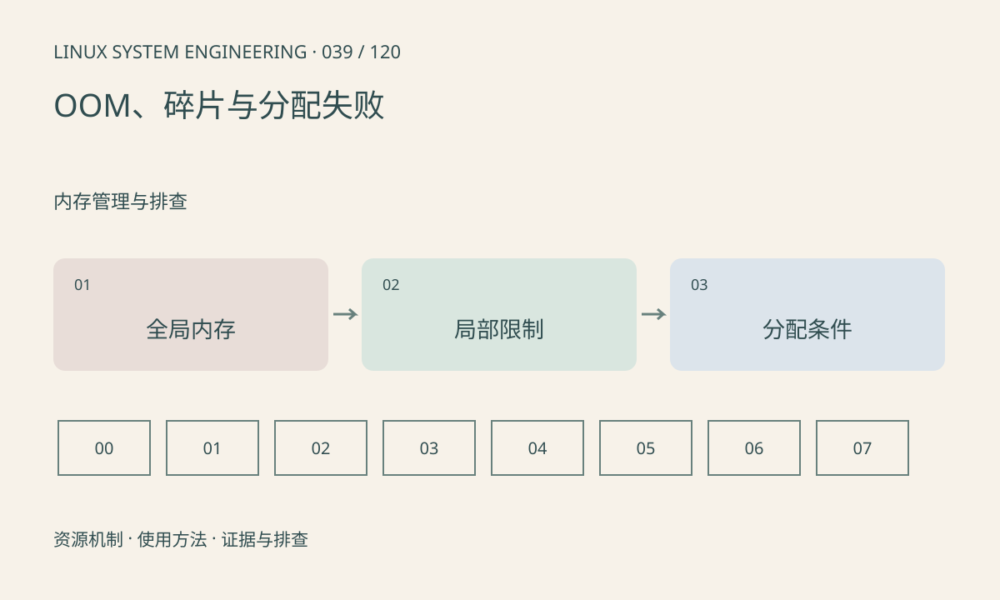

> 第 39 / 120 课 · 内存管理与排查。返回[课程合集](/series/embedded-linux-system-engineering/)。

## 机制与资源关系

分配失败可以来自进程限制、cgroup 限额、地址空间、特定内存区域或连续性要求，未必触发 OOM。OOM 杀掉的进程也未必是泄漏根源，需要结合约束范围和历史曲线。



## 实际用法与观察入口

以下是操作说明；先确认执行环境、工具帮助和目标对象。设备名、PID、地址及项目名示例需要按实际替换，不能将整段命令当通用板端脚本执行。

```sh
cat /proc/self/limits
cat /proc/self/cgroup
cat /proc/buddyinfo
dmesg
```

## 输出解读与排查顺序

先保存失败接口、大小、错误码和上下文，再查全局与局部限制。buddyinfo 的高阶空闲只是线索，不能替代目标分配区和迁移条件分析。不要在生产板故意耗尽 RAM 验证。

### 情境推演

一个受限进程申请失败，主机还有数 GiB 可用。先核对 RLIMIT_AS 和 cgroup 限制；如果是 DMA 连续分配，还需查区域和对齐。总量充足不是所有分配条件成立的证明。

## 练习与参考分析

对“整机有内存但容器 OOM”列证据清单。参考结论：检查 cgroup 的 memory.max 和 memory.events，不能只提供主机 free 输出。

本课练习属于阅读、分析或板端观察。未在目标开发板执行，记录时应写明板型、内核配置、工具版本和原始输出。

## 官方资料与版本边界

- [本课参考资料](https://docs.kernel.org/admin-guide/mm/concepts.html)

内核、工具和厂商 BSP 的支持范围需分别核对。参考资料可能对应较新版本；不要据此推定旧 BSP 支持所有接口。

[上一课：CMA、保留内存与厂商缓冲池](/posts/linux-sys-038.html) · [下一课：内存泄漏、越界与峰值](/posts/linux-sys-040.html)
