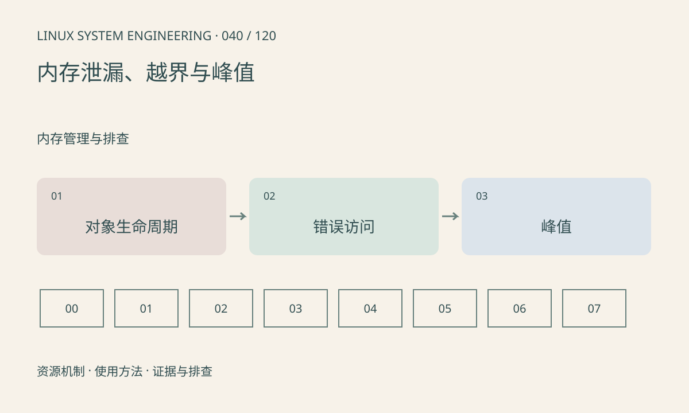

> 第 40 / 120 课 · 内存管理与排查。返回[课程合集](/series/embedded-linux-system-engineering/)。

## 机制与资源关系

泄漏指失去必要的释放路径，峰值高可能只是并发在途数据多。越界和释放后使用则可能破坏分配器，引发很晚才出现的崩溃。业务对象数量、分配调用栈和 RSS 曲线应共同观察。



## 实际用法与观察入口

以下是操作说明；先确认执行环境、工具帮助和目标对象。设备名、PID、地址及项目名示例需要按实际替换，不能将整段命令当通用板端脚本执行。

```sh
# 主机编译自有测试程序，工具链需支持 sanitizer
cc -g -O1 -fsanitize=address,undefined -fno-omit-frame-pointer main.c -o demo
./demo
```

## 输出解读与排查顺序

先在可控输入下复现，再用消毒器定位首次非法访问。sanitizer 增加内存与执行开销，不能拿其性能作为板端基线；目标不支持时可在主机测试可移植部分。

### 情境推演

30fps 生产、20fps 消费且队列无上限时，增长是积压而非“丢失指针”式泄漏。若每帧约 3MB，简化增速约 30MB/s。改成有界队列后再检查回收是否闭环。

## 练习与参考分析

为每类帧对象添加申请、释放和在途计数。参考结论：生产速度大于消费速度造成的排队增长需要背压或丢弃策略，不能只靠 free 修补。

### 独立实验包

主机 20 轮有界对象分配与释放，验证活跃计数；不以 RSS 是否下降判定释放。

```experiment
practice
```

## 官方资料与版本边界

- [本课参考资料](https://gcc.gnu.org/onlinedocs/gcc/Instrumentation-Options.html)

内核、工具和厂商 BSP 的支持范围需分别核对。参考资料可能对应较新版本；不要据此推定旧 BSP 支持所有接口。

[上一课：OOM、碎片与分配失败](/posts/linux-sys-039.html) · [下一课：文件描述符与打开文件状态](/posts/linux-sys-041.html)
