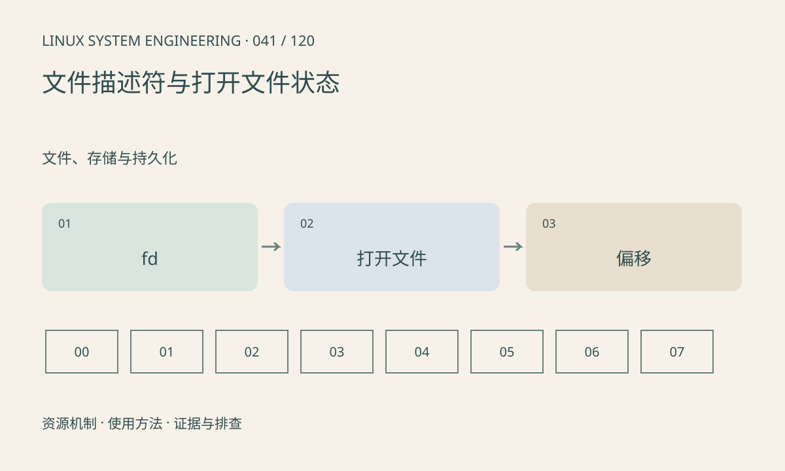

> 第 41 / 120 课 · 文件、存储与持久化。返回[课程合集](/series/embedded-linux-system-engineering/)。

## 机制与资源关系

文件描述符是进程表中的索引，底层打开文件描述保存偏移和状态。dup 与 fork 后的描述符可以引用同一个打开文件描述，因而共享偏移；重新 open 通常得到独立偏移。描述符复用也意味着旧数字不能长期当对象身份。



## 实际用法与观察入口

以下是操作说明；先确认执行环境、工具帮助和目标对象。设备名、PID、地址及项目名示例需要按实际替换，不能将整段命令当通用板端脚本执行。

```sh
ls -l /proc/$$/fd
cat /proc/$$/limits
cat /proc/sys/fs/file-nr
```

## 输出解读与排查顺序

EMFILE 通常指进程描述符限制，ENFILE 涉及系统级打开文件资源。检查所有错误分支的 close，并使用合适的 close-on-exec，避免子程序意外持有资源。

### 情境推演

dup 前读取一个字节、dup 后从另一描述符继续读，会共享同一偏移。若想独立读取同一文件，应重新 open 或使用带显式偏移且适用的 pread，而不是复制整数。

## 练习与参考分析

运行 dup 共享偏移实验，两次读取依次取得 a、b。参考结论：复制 fd 不会复制独立文件游标；异步代码应同时管理对象生命周期。

### 独立实验包

主机 Linux 的有界 C 实验；不访问真实外设，不代表板端时序或性能。 默认入口、源文件和实际运行记录都在下载包中。

```experiment
practice
```

## 官方资料与版本边界

- [本课参考资料](https://man7.org/linux/man-pages/man2/open.2.html)

内核、工具和厂商 BSP 的支持范围需分别核对。参考资料可能对应较新版本；不要据此推定旧 BSP 支持所有接口。

[上一课：内存泄漏、越界与峰值](/posts/linux-sys-040.html) · [下一课：权限、属主、umask 与链接](/posts/linux-sys-042.html)
