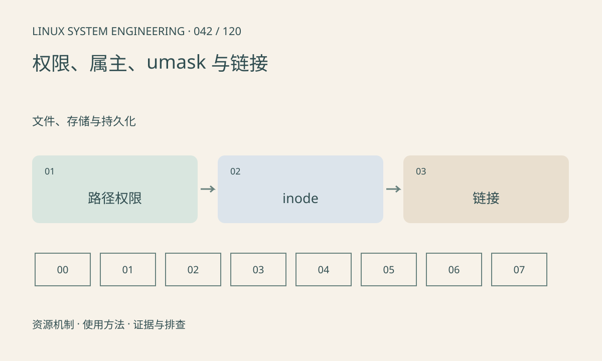

> 第 42 / 120 课 · 文件、存储与持久化。返回[课程合集](/series/embedded-linux-system-engineering/)。

## 机制与资源关系

访问文件需要沿路径具备目录搜索权限；文件自身可读不代表路径可达。umask 在创建时屏蔽权限，软链接保存路径，硬链接引用同一 inode。权限检查还可能受 ACL、capability 和安全模块影响。



## 实际用法与观察入口

以下是操作说明；先确认执行环境、工具帮助和目标对象。设备名、PID、地址及项目名示例需要按实际替换，不能将整段命令当通用板端脚本执行。

```sh
id
umask
ls -ld .
ls -l /dev/null
# 工具存在时逐级检查路径
namei -l /dev/null
```

## 输出解读与排查顺序

先检查报错路径的每一层，再看运行身份和挂载属性。避免用 chmod -R 777 掩盖问题；服务与交互 Shell 的用户、组和工作目录可能不同。

### 情境推演

文件权限是 0644，但上级目录没有搜索权限，普通用户仍不能打开。namei 的逐级结果比单看 ls -l 文件更有帮助；服务还可能运行在不同挂载或安全上下文。

## 练习与参考分析

在临时目录创建原文件、硬链接和软链接并观察 inode。参考结论：删除原文件名不一定删除数据，软链接则可能失效；硬链接通常不能跨文件系统。

### 独立实验包

只在新建临时目录验证链接，不改变项目文件权限。 默认入口、源文件和实际运行记录都在下载包中。

```experiment
practice
```

## 官方资料与版本边界

- [本课参考资料](https://man7.org/linux/man-pages/man7/path_resolution.7.html)

内核、工具和厂商 BSP 的支持范围需分别核对。参考资料可能对应较新版本；不要据此推定旧 BSP 支持所有接口。

[上一课：文件描述符与打开文件状态](/posts/linux-sys-041.html) · [下一课：VFS、挂载点与文件系统](/posts/linux-sys-043.html)
