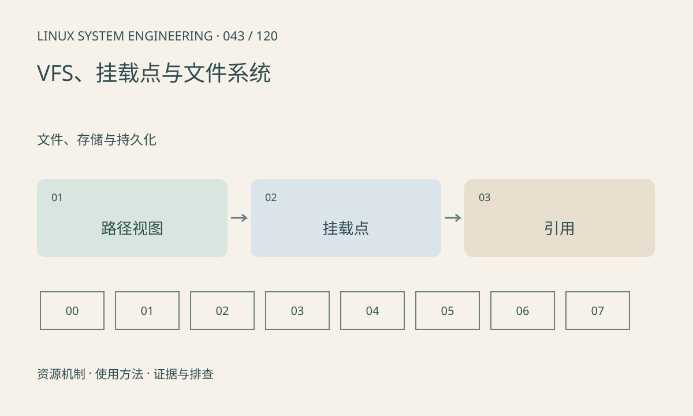

> 第 43 / 120 课 · 文件、存储与持久化。返回[课程合集](/series/embedded-linux-system-engineering/)。

## 机制与资源关系

VFS 为不同文件系统提供统一接口，路径解析经过挂载关系。挂载到非空目录会遮住原内容，并不删除它。进程所在 mount namespace 可能不同，因此宿主机看到的路径未必等于应用看到的路径。



## 实际用法与观察入口

以下是操作说明；先确认执行环境、工具帮助和目标对象。设备名、PID、地址及项目名示例需要按实际替换，不能将整段命令当通用板端脚本执行。

```sh
cat /proc/self/mountinfo
cat /proc/filesystems
df -k
```

## 输出解读与排查顺序

先确认目标路径对应哪次挂载，再检查只读、空间和底层设备。不要在业务使用时随意卸载；“busy”说明还有引用，强制处理可能破坏运行。

### 情境推演

把新文件系统挂在 /data 后旧文件看不见，不代表被删除。不要为了找旧文件在线强制卸载业务分区；先确认挂载关系并在受控环境检查底层目录。

## 练习与参考分析

画出根文件系统、/dev、/proc 和应用数据分区的挂载树。参考结论：同名路径可以处于不同挂载命名空间，排查应使用故障进程视角。

本课练习属于阅读、分析或板端观察。未在目标开发板执行，记录时应写明板型、内核配置、工具版本和原始输出。

## 官方资料与版本边界

- [本课参考资料](https://man7.org/linux/man-pages/man7/mount_namespaces.7.html)

内核、工具和厂商 BSP 的支持范围需分别核对。参考资料可能对应较新版本；不要据此推定旧 BSP 支持所有接口。

[上一课：权限、属主、umask 与链接](/posts/linux-sys-042.html) · [下一课：块设备、分区、eMMC 与 SD](/posts/linux-sys-044.html)
