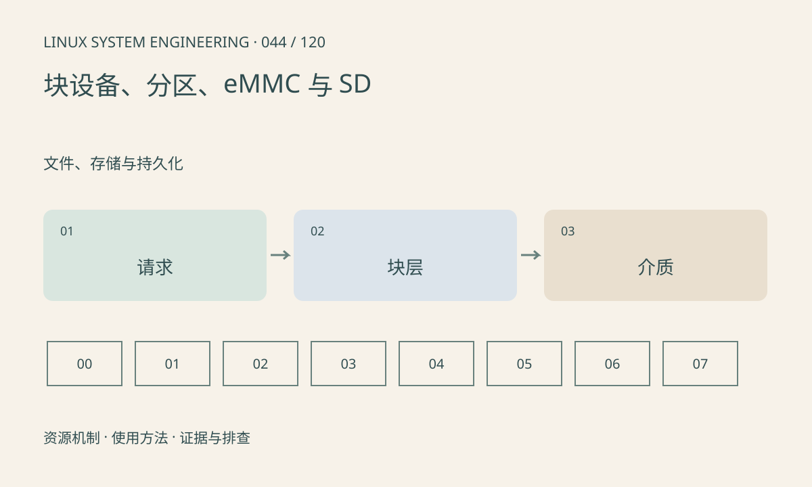

> 第 44 / 120 课 · 文件、存储与持久化。返回[课程合集](/series/embedded-linux-system-engineering/)。

## 机制与资源关系

块层以扇区组织请求，分区在设备上定义范围；eMMC、SD 控制器内部还可能执行擦写管理和垃圾回收。顺序吞吐、随机写延迟、持久化完成不是同一个指标。



## 实际用法与观察入口

以下是操作说明；先确认执行环境、工具帮助和目标对象。设备名、PID、地址及项目名示例需要按实际替换，不能将整段命令当通用板端脚本执行。

```sh
cat /proc/partitions
cat /proc/diskstats
ls /sys/block
# util-linux 可用时
lsblk -o NAME,SIZE,TYPE,MOUNTPOINTS
```

## 输出解读与排查顺序

先匹配设备、分区和挂载，注意 lsblk 参数版本差异。diskstats 需采样差值并解释排队时间。课程不向真实块设备执行 dd 写入、格式化或分区修改。

### 情境推演

应用每次写 4KiB 且同步，顺序写大文件却很快。两者的请求大小和同步策略不同，不能只引用厂商峰值 MB/s 解释。记录 IOPS、延迟分布和设备条件。

## 练习与参考分析

设计仅在独立测试文件上的限量写入实验并说明空间上限。参考结论：页缓存写入速度不能直接当介质持久化速度，需明确同步策略。

本课练习属于阅读、分析或板端观察。未在目标开发板执行，记录时应写明板型、内核配置、工具版本和原始输出。

## 官方资料与版本边界

- [本课参考资料](https://docs.kernel.org/admin-guide/iostats.html)

内核、工具和厂商 BSP 的支持范围需分别核对。参考资料可能对应较新版本；不要据此推定旧 BSP 支持所有接口。

[上一课：VFS、挂载点与文件系统](/posts/linux-sys-043.html) · [下一课：MTD、NOR、NAND、UBI 与 UBIFS](/posts/linux-sys-045.html)
