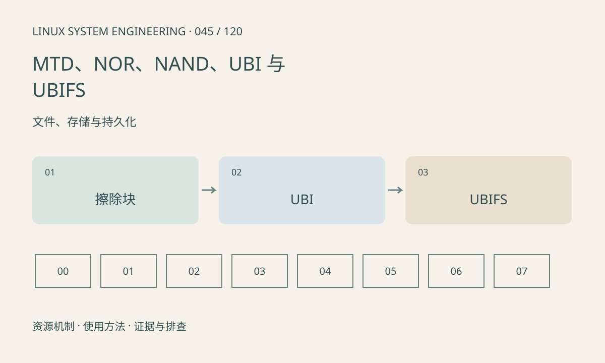

> 第 45 / 120 课 · 文件、存储与持久化。返回[课程合集](/series/embedded-linux-system-engineering/)。

## 机制与资源关系

MTD 暴露原始 Flash 的擦除和写入约束，UBI 在 MTD 之上管理逻辑擦除块和坏块，UBIFS 构建文件系统。带 FTL 的 eMMC 通常走块设备路径，不按原始 NAND 操作。



## 实际用法与观察入口

以下是操作说明；先确认执行环境、工具帮助和目标对象。设备名、PID、地址及项目名示例需要按实际替换，不能将整段命令当通用板端脚本执行。

```sh
cat /proc/mtd
ls /sys/class/mtd
ls /sys/class/ubi
cat /proc/mounts
```

## 输出解读与排查顺序

确认分区编号、擦除块大小和 UBI 绑定关系再分析故障。普通文件复制不能替代 Flash 专用更新流程。本文只读观察，擦除、写入和 attach 操作须在明确恢复路径的测试板另行实施。

### 情境推演

/proc/mtd 显示的是原始 Flash 分区，不能把其编号当 /dev/mmcblk 分区编号。刷写错误设备可能破坏启动链，执行前必须从板级分区表和运行挂载双向确认。

## 练习与参考分析

画 NAND→MTD→UBI→UBIFS，并与 eMMC→块设备→ext4 对照。参考结论：两个系统都叫“Flash”，却不能互换格式化和写镜像命令。

本课练习属于阅读、分析或板端观察。未在目标开发板执行，记录时应写明板型、内核配置、工具版本和原始输出。

## 官方资料与版本边界

- [本课参考资料](https://docs.kernel.org/filesystems/ubifs.html)

内核、工具和厂商 BSP 的支持范围需分别核对。参考资料可能对应较新版本；不要据此推定旧 BSP 支持所有接口。

[上一课：块设备、分区、eMMC 与 SD](/posts/linux-sys-044.html) · [下一课：SquashFS、OverlayFS 与只读系统](/posts/linux-sys-046.html)
