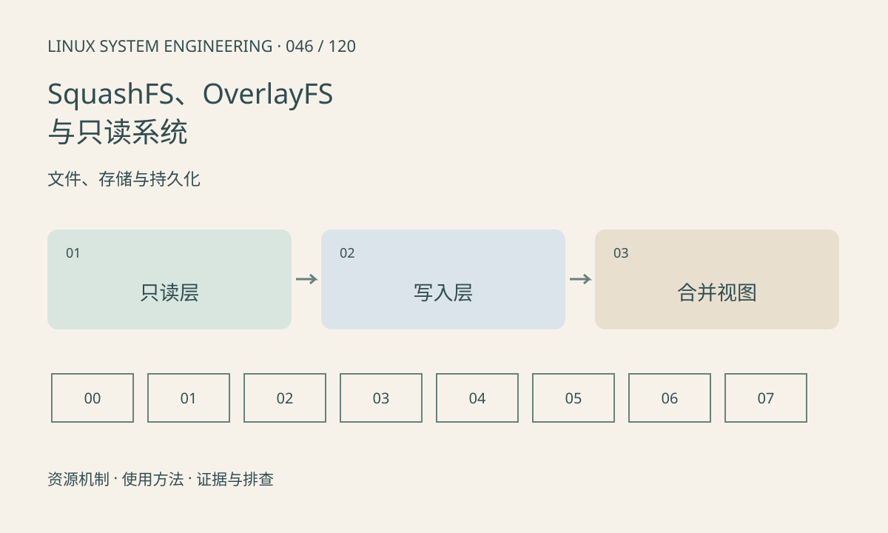

> 第 46 / 120 课 · 文件、存储与持久化。返回[课程合集](/series/embedded-linux-system-engineering/)。

## 机制与资源关系

SquashFS 常用于压缩只读根文件系统，OverlayFS 将只读 lower 与可写 upper 组合。修改文件可能触发 copy-up，删除也可能产生 whiteout；看到文件消失不表示底层镜像被修改。



## 实际用法与观察入口

以下是操作说明；先确认执行环境、工具帮助和目标对象。设备名、PID、地址及项目名示例需要按实际替换，不能将整段命令当通用板端脚本执行。

```sh
cat /proc/mounts
cat /proc/self/mountinfo
df -k
```

## 输出解读与排查顺序

先定位 upper 在持久分区还是 tmpfs。upper 满会让表面可写的根文件系统报错，复制大文件还会放大占用。不要直接删除挂载中的工作目录恢复空间。

### 情境推演

删除 lower 文件后 df 未释放 lower 空间，是因为只读镜像未改动且 upper 可能只增加了删除标记。清理策略应针对可写层和应用数据，而不是期望删除镜像文件回收空间。

## 练习与参考分析

纸面推演修改 lower 中一个大文件对 upper 的影响。参考结论：镜像大小和运行时可写层容量需要分别预算，升级时还要处理旧 upper 与新 lower 的兼容。

本课练习属于阅读、分析或板端观察。未在目标开发板执行，记录时应写明板型、内核配置、工具版本和原始输出。

## 官方资料与版本边界

- [本课参考资料](https://docs.kernel.org/filesystems/overlayfs.html)

内核、工具和厂商 BSP 的支持范围需分别核对。参考资料可能对应较新版本；不要据此推定旧 BSP 支持所有接口。

[上一课：MTD、NOR、NAND、UBI 与 UBIFS](/posts/linux-sys-045.html) · [下一课：缓冲写入、fsync 与掉电一致性](/posts/linux-sys-047.html)
