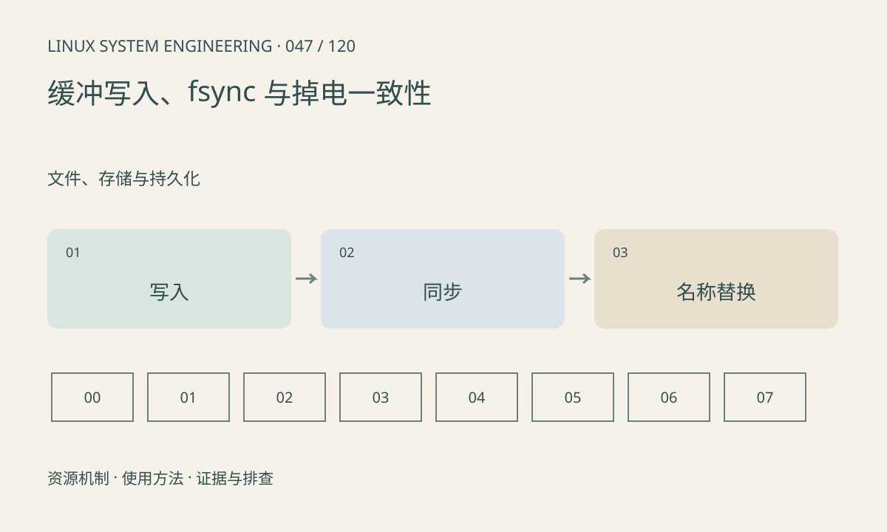

> 第 47 / 120 课 · 文件、存储与持久化。返回[课程合集](/series/embedded-linux-system-engineering/)。

## 机制与资源关系

write 成功通常表示数据进入内核处理路径，不一定到达非易失介质。持久化还涉及文件系统、块层及设备缓存。用临时文件替换配置时，应考虑文件同步、rename 和父目录同步，且确认文件系统支持。



## 实际用法与观察入口

以下是操作说明；先确认执行环境、工具帮助和目标对象。设备名、PID、地址及项目名示例需要按实际替换，不能将整段命令当通用板端脚本执行。

```sh
# 查看当前文件系统和挂载条件
cat /proc/mounts
# 配套实验仅操作临时目录
sh run.sh
```

## 输出解读与排查顺序

应用崩溃一致性与真实掉电一致性不同。实验可以验证调用和正常重启读取，不能证明电源切断后的介质行为。不要用全局 sync 的耗时推算单个文件的写入延迟。

### 情境推演

配置写到一半进程崩溃可能留下半文件。临时文件写完并同步后再替换名称，可改进更新协议；目录同步与存储设备持久化保证仍需按实际文件系统和硬件验证。

## 练习与参考分析

运行临时文件→fsync→rename→目录 fsync 示例。参考结论：原子替换名称和保证掉电持久性是不同要求，真实产品仍需受控掉电验证。

### 独立实验包

主机 Linux 的有界 C 实验；不访问真实外设，不代表板端时序或性能。 默认入口、源文件和实际运行记录都在下载包中。

```experiment
practice
```

## 官方资料与版本边界

- [本课参考资料](https://man7.org/linux/man-pages/man2/fsync.2.html)

内核、工具和厂商 BSP 的支持范围需分别核对。参考资料可能对应较新版本；不要据此推定旧 BSP 支持所有接口。

[上一课：SquashFS、OverlayFS 与只读系统](/posts/linux-sys-046.html) · [下一课：空间满、inode 耗尽与 I/O 慢](/posts/linux-sys-048.html)
