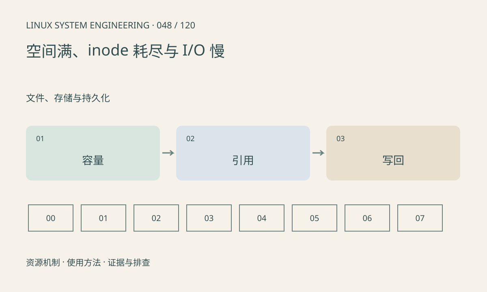

> 第 48 / 120 课 · 文件、存储与持久化。返回[课程合集](/series/embedded-linux-system-engineering/)。

## 机制与资源关系

df 统计文件系统使用，du 汇总可见路径文件，两者口径不同。被删除但仍打开的文件继续占空间；小文件很多可能耗尽 inode。只读挂载还可能是错误保护结果，而不是权限不足。



## 实际用法与观察入口

以下是操作说明；先确认执行环境、工具帮助和目标对象。设备名、PID、地址及项目名示例需要按实际替换，不能将整段命令当通用板端脚本执行。

```sh
df -k
df -i
cat /proc/mounts
# 工具存在且权限足够时
lsof +L1
```

## 输出解读与排查顺序

先保存错误码，再依次核对空间、inode、配额、挂载和内核错误。I/O 慢要区分应用缓冲、写回和介质排队；不要没证据就在线 fsck 或强制改为可写。

### 情境推演

日志已经 unlink，但进程仍保持打开，du 看不到路径而 df 仍计入空间。定位 deleted 句柄后通过应用正确重开日志，避免截断未知 /proc/PID/fd 目标造成数据损坏。

## 练习与参考分析

解释删除日志后 df 不下降的情况。参考结论：检查进程是否仍持有已删文件，正确轮转或关闭句柄；继续删除其他文件未必能解决根因。

本课练习属于阅读、分析或板端观察。未在目标开发板执行，记录时应写明板型、内核配置、工具版本和原始输出。

## 官方资料与版本边界

- [本课参考资料](https://man7.org/linux/man-pages/man2/statfs.2.html)

内核、工具和厂商 BSP 的支持范围需分别核对。参考资料可能对应较新版本；不要据此推定旧 BSP 支持所有接口。

[上一课：缓冲写入、fsync 与掉电一致性](/posts/linux-sys-047.html) · [下一课：阻塞、非阻塞与短读写](/posts/linux-sys-049.html)
