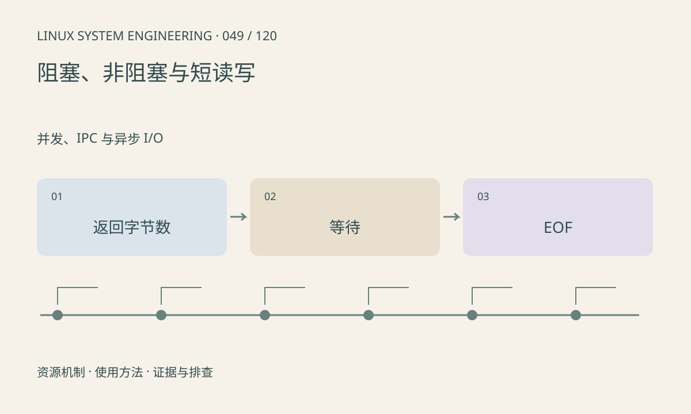

> 第 49 / 120 课 · 并发、IPC 与异步 I/O。返回[课程合集](/series/embedded-linux-system-engineering/)。

## 机制与资源关系

read、write 返回的是本次处理字节数，可能小于请求。非阻塞无数据时可能返回 EAGAIN，EINTR 则提示被信号打断。EOF、暂时不可读和真实错误必须分开；流式传输没有天然消息边界。



## 实际用法与观察入口

以下是操作说明；先确认执行环境、工具帮助和目标对象。设备名、PID、地址及项目名示例需要按实际替换，不能将整段命令当通用板端脚本执行。

```sh
# 在本课独立代码包中
sh run.sh
```

## 输出解读与排查顺序

循环处理已完成偏移，检查返回值为零及 errno。EAGAIN 应等待就绪，不能无延时忙轮询。设备接口可能有自己的读写约定，需查对应驱动 ABI。

### 情境推演

请求读 100 字节只返回 12 字节是合法短读。应保留这 12 字节并继续组帧；返回 0 表示相应流结束，返回 -1 才查 errno。不能把非满长读一律当错误丢掉。

## 练习与参考分析

实验读取空的非阻塞 pipe，确认 EAGAIN；写入后读取数据，关闭写端后确认 EOF。参考结论：这三种状态不能合并成一次“读取失败”。

### 独立实验包

主机 Linux 的有界 C 实验；不访问真实外设，不代表板端时序或性能。 默认入口、源文件和实际运行记录都在下载包中。

```experiment
practice
```

## 官方资料与版本边界

- [本课参考资料](https://man7.org/linux/man-pages/man2/read.2.html)

内核、工具和厂商 BSP 的支持范围需分别核对。参考资料可能对应较新版本；不要据此推定旧 BSP 支持所有接口。

[上一课：空间满、inode 耗尽与 I/O 慢](/posts/linux-sys-048.html) · [下一课：select、poll 与 epoll](/posts/linux-sys-050.html)
