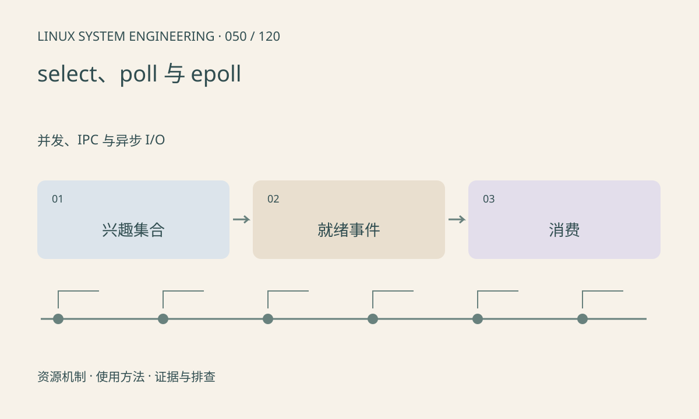

> 第 50 / 120 课 · 并发、IPC 与异步 I/O。返回[课程合集](/series/embedded-linux-system-engineering/)。

## 机制与资源关系

就绪通知表示当前操作有机会不阻塞，并不保证完整消息到达。epoll 的 LT 与 ET 对事件处理方式不同；ET 常配合非阻塞 I/O，读写到 EAGAIN，否则可能留下未处理数据。



## 实际用法与观察入口

以下是操作说明；先确认执行环境、工具帮助和目标对象。设备名、PID、地址及项目名示例需要按实际替换，不能将整段命令当通用板端脚本执行。

```sh
# 运行本课 poll 示例，限定等待时间
sh run.sh
```

## 输出解读与排查顺序

设计超时和错误事件处理，区分 POLLIN、POLLHUP、POLLERR。多个消费者会改变就绪状态；收到事件后仍需检查系统调用结果。select 还受 fd 集合表示能力约束。

### 情境推演

epoll ET 收到一次通知后只读一个字节，剩余数据可能没有新的边沿通知。正确设计常要求非阻塞循环读到 EAGAIN，并对每次返回值与连接关闭分别处理。

## 练习与参考分析

先 poll 空管道得到超时，再写入并获得就绪。参考结论：有超时不是业务成功，必须继续判断返回事件和实际读取字节数。

### 独立实验包

主机 Linux 的有界 C 实验；不访问真实外设，不代表板端时序或性能。 默认入口、源文件和实际运行记录都在下载包中。

```experiment
practice
```

## 官方资料与版本边界

- [本课参考资料](https://man7.org/linux/man-pages/man7/epoll.7.html)

内核、工具和厂商 BSP 的支持范围需分别核对。参考资料可能对应较新版本；不要据此推定旧 BSP 支持所有接口。

[上一课：阻塞、非阻塞与短读写](/posts/linux-sys-049.html) · [下一课：pipe、FIFO 与 Unix socket](/posts/linux-sys-051.html)
