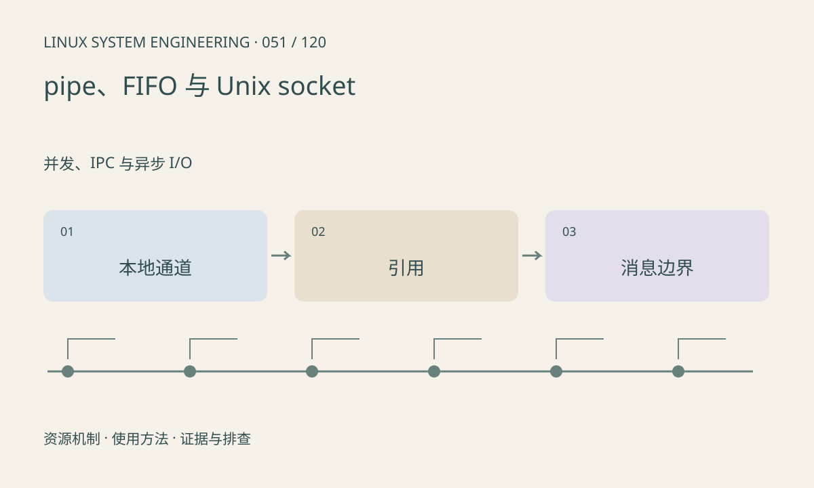

> 第 51 / 120 课 · 并发、IPC 与异步 I/O。返回[课程合集](/series/embedded-linux-system-engineering/)。

## 机制与资源关系

pipe 常用于有亲缘进程，FIFO 提供文件系统入口，Unix socket 适合本机双向通信。流式 socket 仍需帧协议；传递文件描述符要使用 SCM_RIGHTS 等接口，不能发送一个整数就让另一进程获得句柄。



## 实际用法与观察入口

以下是操作说明；先确认执行环境、工具帮助和目标对象。设备名、PID、地址及项目名示例需要按实际替换，不能将整段命令当通用板端脚本执行。

```sh
cat /proc/net/unix
# 完整工具可用时
ss -x -a
```

## 输出解读与排查顺序

管道 EOF 要等所有写端引用关闭，fork 后遗漏 close 是常见挂住原因。Unix socket 路径还涉及目录权限和清理；对端退出时检查错误及 SIGPIPE 策略。

### 情境推演

父子进程各继承了 pipe 两端，但消费者读不到 EOF，常见原因是某处仍持有写端。画出每个进程的 fd 表，关闭各自不用的端，才能理解流结束条件。

## 练习与参考分析

运行 socketpair 往返实验，标出两端关闭时机。参考结论：进程间的 fd 数字只在各自表内有效，相同数字不代表同一资源。

### 独立实验包

主机 Linux 的有界 C 实验；不访问真实外设，不代表板端时序或性能。 默认入口、源文件和实际运行记录都在下载包中。

```experiment
practice
```

## 官方资料与版本边界

- [本课参考资料](https://man7.org/linux/man-pages/man7/unix.7.html)

内核、工具和厂商 BSP 的支持范围需分别核对。参考资料可能对应较新版本；不要据此推定旧 BSP 支持所有接口。

[上一课：select、poll 与 epoll](/posts/linux-sys-050.html) · [下一课：共享内存与消息队列](/posts/linux-sys-052.html)
