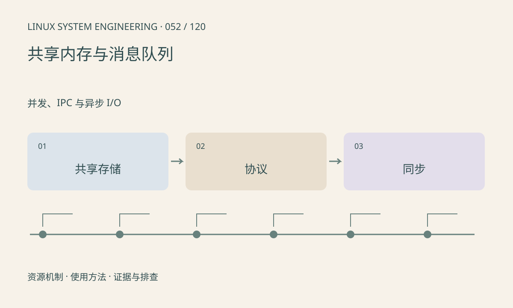

> 第 52 / 120 课 · 并发、IPC 与异步 I/O。返回[课程合集](/series/embedded-linux-system-engineering/)。

## 机制与资源关系

共享内存共享的是数据存储，不自动提供互斥和完成通知。协议需要版本、长度、序号及所有权；跨进程不能保存只对本进程有效的普通指针。POSIX 与 System V IPC 的命名和生命周期不同。



## 实际用法与观察入口

以下是操作说明；先确认执行环境、工具帮助和目标对象。设备名、PID、地址及项目名示例需要按实际替换，不能将整段命令当通用板端脚本执行。

```sh
cat /proc/sysvipc/shm
cat /proc/sysvipc/msg
ls /dev/shm
```

## 输出解读与排查顺序

这些入口只覆盖相应实现，不代表所有共享对象。进程崩溃可能留下命名资源或不完整状态；恢复必须考虑代际与锁所有者，而不是只重新连接地址。

### 情境推演

共享结构里保存 char*，另一个进程按这个数值解引用可能崩溃。改为区域内偏移并检查边界；同时约定结构版本、发布顺序和进程重启后的代际识别。

## 练习与参考分析

本课用 MAP_SHARED 和 fork 共享整数，以 wait 确认子进程完成。参考结论：这是简单阶段同步；并发读写仍需进程共享同步原语或明确的原子协议。

### 独立实验包

主机 Linux 的有界 C 实验；不访问真实外设，不代表板端时序或性能。 默认入口、源文件和实际运行记录都在下载包中。

```experiment
practice
```

## 官方资料与版本边界

- [本课参考资料](https://man7.org/linux/man-pages/man7/shm_overview.7.html)

内核、工具和厂商 BSP 的支持范围需分别核对。参考资料可能对应较新版本；不要据此推定旧 BSP 支持所有接口。

[上一课：pipe、FIFO 与 Unix socket](/posts/linux-sys-051.html) · [下一课：mutex、条件变量与信号量](/posts/linux-sys-053.html)
