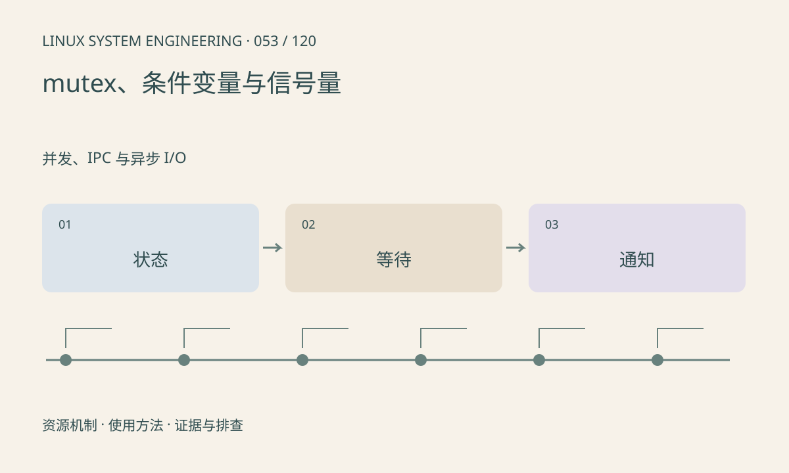

> 第 53 / 120 课 · 并发、IPC 与异步 I/O。返回[课程合集](/series/embedded-linux-system-engineering/)。

## 机制与资源关系

mutex 保护状态不变量，条件变量用于等待状态变化。等待条件必须在同一锁保护下用 while 重查，以处理虚假唤醒和其他消费者抢先取走资源。信号量计数的是许可，不等同于任意条件。



## 实际用法与观察入口

以下是操作说明；先确认执行环境、工具帮助和目标对象。设备名、PID、地址及项目名示例需要按实际替换，不能将整段命令当通用板端脚本执行。

```sh
# 本课两个线程通过条件变量传递一个结果
sh run.sh
```

## 输出解读与排查顺序

生产者先更新状态再通知，消费者在循环中检查。退出路径也要唤醒等待者并销毁同步对象。pthread API 常直接返回错误码，不应只读 errno。

### 情境推演

两个消费者同时被唤醒但只有一个任务，第二个拿到锁后条件又变为假。while 重查会继续等待，if 则可能读空队列。条件变量通知本身不储存任务。

## 练习与参考分析

把单次 if 等待改为 while 并解释必要性。参考结论：通知不是数据本身，真正的业务条件保存在受锁保护的共享状态中。

### 独立实验包

主机 Linux 的有界 C 实验；不访问真实外设，不代表板端时序或性能。 默认入口、源文件和实际运行记录都在下载包中。

```experiment
practice
```

## 官方资料与版本边界

- [本课参考资料](https://man7.org/linux/man-pages/man3/pthread_cond_wait.3p.html)

内核、工具和厂商 BSP 的支持范围需分别核对。参考资料可能对应较新版本；不要据此推定旧 BSP 支持所有接口。

[上一课：共享内存与消息队列](/posts/linux-sys-052.html) · [下一课：原子操作、内存序与数据竞争](/posts/linux-sys-054.html)
