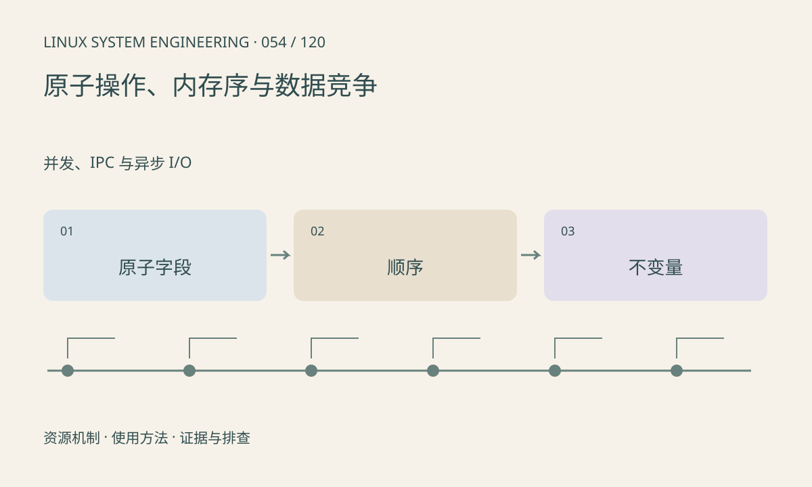

> 第 54 / 120 课 · 并发、IPC 与异步 I/O。返回[课程合集](/series/embedded-linux-system-engineering/)。

## 机制与资源关系

C 的 volatile 不提供线程同步或原子性。C11 原子可以避免单个原子对象的数据竞争，但多字段协议仍需证明发布顺序。release/acquire 可用于发布数据，relaxed 则不提供同等跨对象顺序。



## 实际用法与观察入口

以下是操作说明；先确认执行环境、工具帮助和目标对象。设备名、PID、地址及项目名示例需要按实际替换，不能将整段命令当通用板端脚本执行。

```sh
# 使用支持 C11 atomics 的主机工具链
sh run.sh
```

## 输出解读与排查顺序

先用互斥锁建立正确版本，再证明必要的无锁协议。原子类型不保证在所有目标上 lock-free；目标工具链可能需要 libatomic。用户态内存序不能替代设备 DMA 同步。

### 情境推演

原子递增队列计数不会自动保护数组槽内容。如果计数先可见而数据尚未发布，消费者可能读旧值。发布协议必须同时证明槽所有权、数据完成和回收顺序。

## 练习与参考分析

两个线程各做 10000 次 atomic_fetch_add，join 后应为 20000。参考结论：本例仅验证计数器，不能推广为任意队列已经线程安全。

### 独立实验包

主机 Linux 的有界 C 实验；不访问真实外设，不代表板端时序或性能。 默认入口、源文件和实际运行记录都在下载包中。

```experiment
practice
```

## 官方资料与版本边界

- [本课参考资料](https://man7.org/linux/man-pages/man7/pthreads.7.html)

内核、工具和厂商 BSP 的支持范围需分别核对。参考资料可能对应较新版本；不要据此推定旧 BSP 支持所有接口。

[上一课：mutex、条件变量与信号量](/posts/linux-sys-053.html) · [下一课：eventfd、timerfd 与 signalfd](/posts/linux-sys-055.html)
