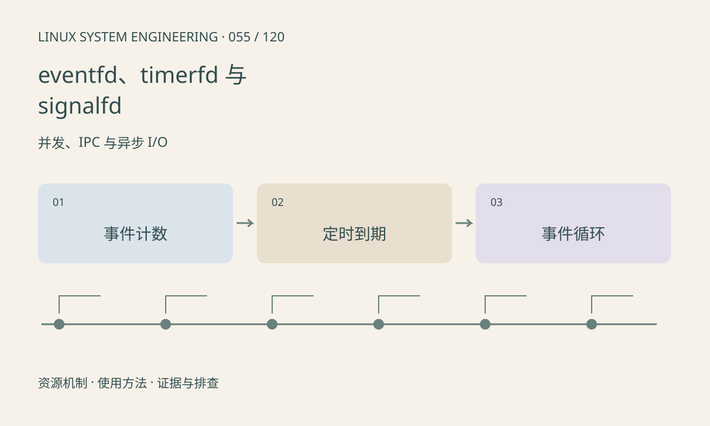

> 第 55 / 120 课 · 并发、IPC 与异步 I/O。返回[课程合集](/series/embedded-linux-system-engineering/)。

## 机制与资源关系

这些 Linux 接口把事件、定时器和信号接入 fd 事件循环。eventfd 默认读取累积计数，timerfd 报告到期次数；signalfd 通常需要先阻塞目标信号，避免传统处理路径与读取竞争。



## 实际用法与观察入口

以下是操作说明；先确认执行环境、工具帮助和目标对象。设备名、PID、地址及项目名示例需要按实际替换，不能将整段命令当通用板端脚本执行。

```sh
# 本课演示 eventfd 累积计数和一次 timerfd 到期
sh run.sh
```

## 输出解读与排查顺序

读写长度和数据类型应遵守接口，不能用单字节读取替代 64 位计数。定时器选择 CLOCK_MONOTONIC 可避免墙上时间跳变，但仍需区分到期与线程实际执行的时刻。

### 情境推演

timerfd 读到 3 表示累计到期次数，不应当作“一个事件只执行一次”而无记录地丢掉周期。业务应明确补算、跳过还是告警，并区分定时器到期和处理延迟。

## 练习与参考分析

向 eventfd 写 2 和 3，默认模式读取应得 5。参考结论：通知可以合并，业务处理应依计数或真实队列状态，而不是假设每次唤醒恰好对应一件事。

### 独立实验包

主机 Linux 的有界 C 实验；不访问真实外设，不代表板端时序或性能。 默认入口、源文件和实际运行记录都在下载包中。

```experiment
practice
```

## 官方资料与版本边界

- [本课参考资料](https://man7.org/linux/man-pages/man2/eventfd.2.html)

内核、工具和厂商 BSP 的支持范围需分别核对。参考资料可能对应较新版本；不要据此推定旧 BSP 支持所有接口。

[上一课：原子操作、内存序与数据竞争](/posts/linux-sys-054.html) · [下一课：死锁、优先级反转与队列背压](/posts/linux-sys-056.html)
