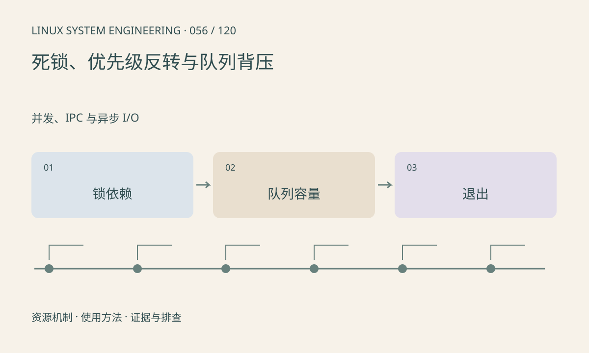

> 第 56 / 120 课 · 并发、IPC 与异步 I/O。返回[课程合集](/series/embedded-linux-system-engineering/)。

## 机制与资源关系

两个线程以相反顺序持有锁会形成等待环。优先级反转中，高优先级线程可能等待低优先级持锁者；优先级继承能处理某些情况，却不能修复任意死锁。生产消费速率不平衡则需要有界队列与背压。



## 实际用法与观察入口

以下是操作说明；先确认执行环境、工具帮助和目标对象。设备名、PID、地址及项目名示例需要按实际替换，不能将整段命令当通用板端脚本执行。

```sh
# 替换为目标 PID；附加调试可能影响时序
ls /proc/1234/task
cat /proc/1234/wchan
```

## 输出解读与排查顺序

画锁依赖图并记录持锁时长，禁止持锁进行无界外部 I/O。队列满时明确阻塞、丢新、丢旧或降速策略；视频实时任务可能更关心结果年龄而非处理全部旧帧。

### 情境推演

停止生产者后消费者还在空队列等待，join 永远不返回。停止状态也必须放入受保护谓词并通知等待者，退出协议和正常传递协议要一起设计。

## 练习与参考分析

分析生产 30fps、消费 20fps 的无限队列。参考结论：每秒积压约 10 帧，增加缓冲只推迟失败；需要改变速率或选择业务可接受的丢弃策略。

本课练习属于阅读、分析或板端观察。未在目标开发板执行，记录时应写明板型、内核配置、工具版本和原始输出。

## 官方资料与版本边界

- [本课参考资料](https://docs.kernel.org/locking/rt-mutex.html)

内核、工具和厂商 BSP 的支持范围需分别核对。参考资料可能对应较新版本；不要据此推定旧 BSP 支持所有接口。

[上一课：eventfd、timerfd 与 signalfd](/posts/linux-sys-055.html) · [下一课：device、driver、bus 与绑定](/posts/linux-sys-057.html)
