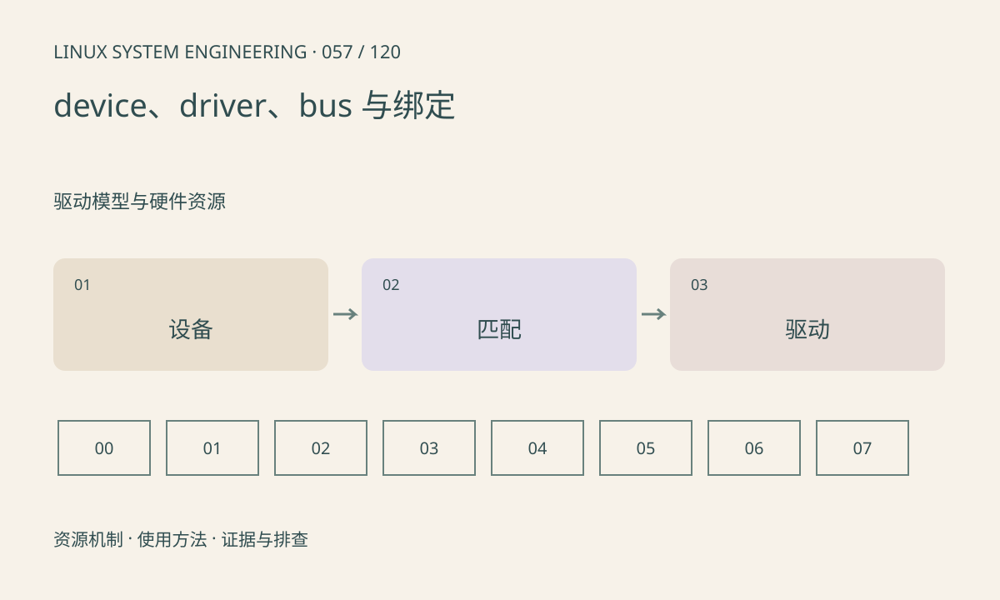

> 第 57 / 120 课 · 驱动模型与硬件资源。返回[课程合集](/series/embedded-linux-system-engineering/)。

## 机制与资源关系

设备描述存在不等于驱动已绑定。总线匹配规则把设备与候选驱动关联，probe 再申请资源并初始化。驱动模块已加载也可能没有匹配设备，内建驱动则不会出现在 lsmod 中。



## 实际用法与观察入口

以下是操作说明；先确认执行环境、工具帮助和目标对象。设备名、PID、地址及项目名示例需要按实际替换，不能将整段命令当通用板端脚本执行。

```sh
ls /sys/bus/platform/devices
ls /sys/bus/platform/drivers
cat /proc/modules
```

## 输出解读与排查顺序

从具体设备目录检查 driver 链接，再查日志和 modalias。不要在业务运行时随意写 bind/unbind，这会改变设备生命周期并可能终止 DMA。

### 情境推演

模块出现在 /proc/modules，但设备目录没有 driver 链接。先查匹配条件与 probe 日志；模块存在只能证明代码加载，不说明这个具体设备由它管理。

## 练习与参考分析

选择一台实际设备，记录总线、设备路径、匹配信息、驱动和用户接口。参考结论：/dev 节点是后续接口，不能单凭节点名倒推完整绑定关系。

本课练习属于阅读、分析或板端观察。未在目标开发板执行，记录时应写明板型、内核配置、工具版本和原始输出。

## 官方资料与版本边界

- [本课参考资料](https://docs.kernel.org/driver-api/driver-model/binding.html)

内核、工具和厂商 BSP 的支持范围需分别核对。参考资料可能对应较新版本；不要据此推定旧 BSP 支持所有接口。

[上一课：死锁、优先级反转与队列背压](/posts/linux-sys-056.html) · [下一课：platform、设备树与 probe](/posts/linux-sys-058.html)
