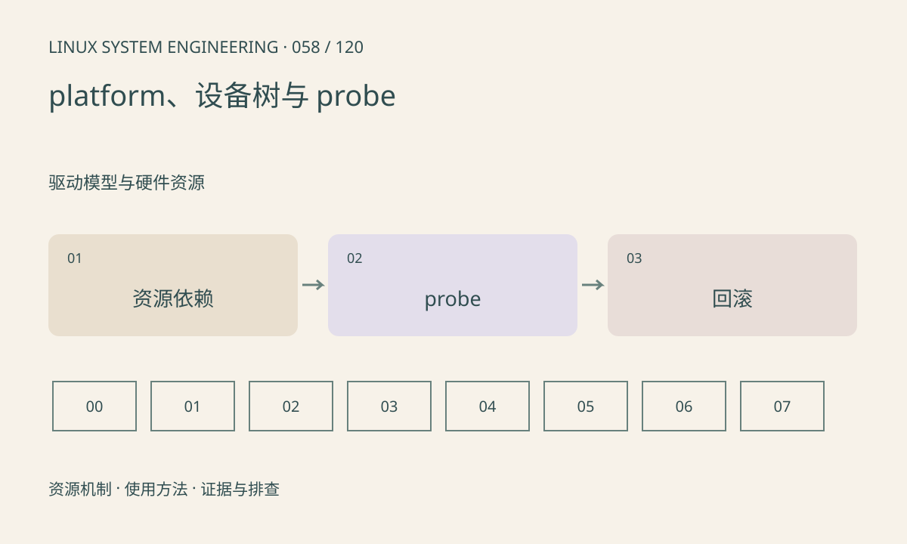

> 第 58 / 120 课 · 驱动模型与硬件资源。返回[课程合集](/series/embedded-linux-system-engineering/)。

## 机制与资源关系

platform 设备常用于不能自行枚举的 SoC 外设。设备树提供地址、中断和供应资源，驱动在 probe 中获取它们。依赖设备尚未就绪时可能返回 EPROBE_DEFER，稍后重试，不能当普通永久错误吞掉。



## 实际用法与观察入口

以下是操作说明；先确认执行环境、工具帮助和目标对象。设备名、PID、地址及项目名示例需要按实际替换，不能将整段命令当通用板端脚本执行。

```sh
ls /sys/bus/platform/devices
dmesg
# 接口存在且有权限时
cat /sys/kernel/debug/devices_deferred
```

## 输出解读与排查顺序

检查节点是否启用、compatible 是否匹配、供应时钟电源是否有驱动。devm 管理资源释放，不自动解决所有异步工作和 DMA 停止顺序。

### 情境推演

probe 申请 GPIO 成功后申请 IRQ 失败，应释放前面非托管资源。若存在异步任务，devm 自动释放前还需停止任务，不能让工作线程继续使用已销毁对象。

## 练习与参考分析

构造“sensor 等 regulator、regulator 驱动没启用”的依赖图。参考结论：反复重试 sensor 寄存器不会补齐上游供应者，应先修复资源链。

本课练习属于阅读、分析或板端观察。未在目标开发板执行，记录时应写明板型、内核配置、工具版本和原始输出。

## 官方资料与版本边界

- [本课参考资料](https://docs.kernel.org/driver-api/driver-model/platform.html)

内核、工具和厂商 BSP 的支持范围需分别核对。参考资料可能对应较新版本；不要据此推定旧 BSP 支持所有接口。

[上一课：device、driver、bus 与绑定](/posts/linux-sys-057.html) · [下一课：模块、固件加载与版本匹配](/posts/linux-sys-059.html)
