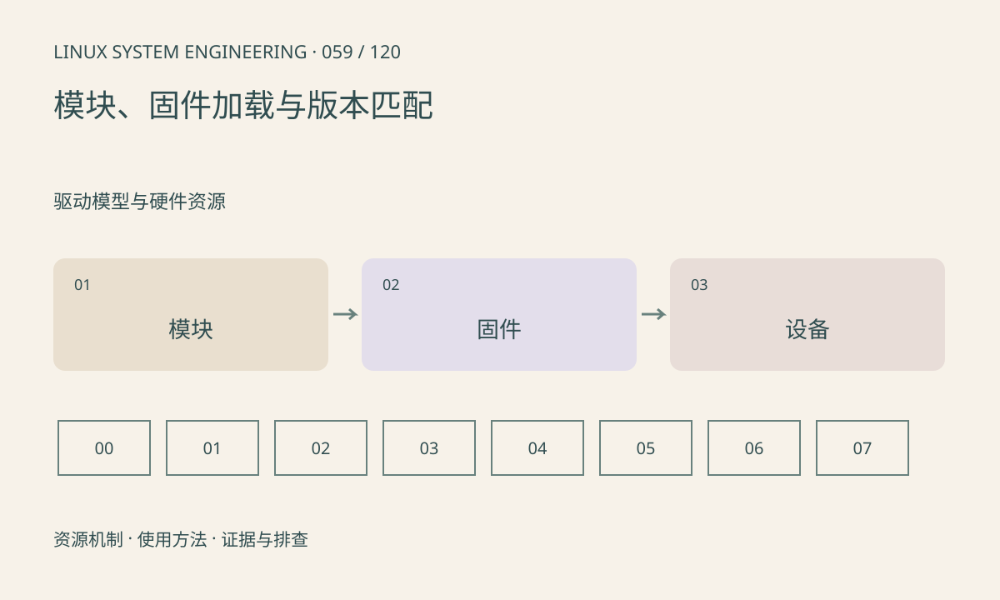

> 第 59 / 120 课 · 驱动模型与硬件资源。返回[课程合集](/series/embedded-linux-system-engineering/)。

## 机制与资源关系

ko 在内核执行，firmware blob 是设备可能加载的数据或代码，两者不能互换。modprobe 可处理依赖，insmod 直接加载指定文件；模块加载还受符号、签名和版本约束。



## 实际用法与观察入口

以下是操作说明；先确认执行环境、工具帮助和目标对象。设备名、PID、地址及项目名示例需要按实际替换，不能将整段命令当通用板端脚本执行。

```sh
uname -r
cat /proc/modules
# 替换成实际模块名，只读查询
modinfo your_module
modprobe --show-depends your_module
```

## 输出解读与排查顺序

先读内核给出的失败原因，再核对模块构建环境。firmware request 失败需查请求文件名和根文件系统可见性；不能把任意相近版本固件重命名替代。本文不加载或卸载模块。

### 情境推演

firmware request 请求 camera.bin，但文件在另一个路径或 initramfs 未包含。先按日志精确核对文件名与加载阶段，而不是把 ko 重编一次或改成其他芯片固件。

## 练习与参考分析

分别列出 unknown symbol、invalid module format、firmware not found 的检查路径。参考结论：它们发生在不同边界，不应统一归为驱动损坏。

本课练习属于阅读、分析或板端观察。未在目标开发板执行，记录时应写明板型、内核配置、工具版本和原始输出。

## 官方资料与版本边界

- [本课参考资料](https://docs.kernel.org/driver-api/firmware/index.html)

内核、工具和厂商 BSP 的支持范围需分别核对。参考资料可能对应较新版本；不要据此推定旧 BSP 支持所有接口。

[上一课：platform、设备树与 probe](/posts/linux-sys-058.html) · [下一课：MMIO 与资源申请](/posts/linux-sys-060.html)
